# Splunk SOC Home Lab — SIEM Detection & Alerting

A hands-on security operations home lab: utilizing Splunk as a SIEM, forwarding telemetry from a monitored Windows host, then simulating a brute-force attack, detect it with SPL, and automatically alert on it making use of notifications pushed to Discord.

**Skills demonstrated:** SIEM deployment · log forwarding · Sysmon telemetry · SPL (Search Processing Language) · basic detection engineering · scheduled alerting · Mapped detection to MITRE ATT&CK (T1110) · alert integration via webhook · <span style="color:red;">Wireshark analysis · incident documentation · Wazuh Active Response · API authentication · TLS certificates · RBAC</span>.

---

## Lab Architecture

<span style="color:red;">The lab began with three virtual machines on an isolated host-only network, then added an Ubuntu Wazuh manager for response testing.</span>

| Role | Machine | Purpose |
|------|---------|---------|
| SIEM | Splunk Enterprise VM | Receives, indexes, and searches all logs; runs detections and alerts |
| Endpoint | Windows VM (monitored host) | The target being monitored and attacked; runs Sysmon + Universal Forwarder <span style="color:red;">+ Wazuh agent 001</span> |
| Attacker | Kali Linux VM | Launches the simulated brute-force attack with Hydra |
| <span style="color:red;">Response manager</span> | <span style="color:red;">Ubuntu VM</span> | <span style="color:red;">Runs the Wazuh manager and API; sends responses to the Windows agent</span> |

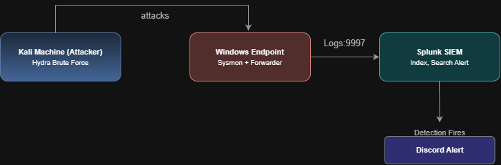

---

## Phase 1: Installing Splunk

Install Splunk Enterprise, then log in on port 8000 in your preferred web browser using the credentials you made when you downloaded Splunk Enterprise.

---

## Phase 2: Loading a pre-built pile of security logs to study — BOTSv3 (Boss of the SOC v3)

- Look for the BOTSv3 repository on GitHub and download it.
- Install it as an app on your Splunk.

### Learnings from Phase 2

To identify all the sourcetypes, use the search bar to look up all the sourcetypes:

```
index="your index" | stats count by sourcetype | sort - count
```

- This searches our index, counts the sourcetypes we have, and sorts them in descending order — so the sourcetype with the most events logged is on top.
- Some sourcetypes are self-explanatory such as `linux_secure` and `WinEventLog`. Most names hint at their source, but to actually see what they are or what they contain, inspect their raw event or look them up.

**Reverse Mapping and Forward Mapping**

- Reverse mapping uses the IP to ask DNS for the hostname connected to it.
- Forward mapping uses the hostname it got from reverse mapping, then asks DNS what IP the hostname points to — to validate whether they truly match.

Verdict: a failed FCrDNS (Forward-Confirmed Reverse DNS) is not often a sign of compromise, but it is considered by some as a minor flag.

If you don't know what field to look for, you can use the field sidebar on the left side.

The workflow is always **discover → confirm → query**.

The `host` field is usually the victim, not the attacker. The constant value (e.g. a constant IP) in any event is most likely always the machine that is writing the log.

---

## Phase 3: Endpoint telemetry with Sysmon + Universal Forwarder

### Sysmon

Sysmon is a free Microsoft Sysinternals tool which logs detailed system activities on the Windows operating system — such as process creation, network connections, and any changes within files or the registry — which Windows does not normally record by default. We use Sysmon so we can get log/event information from the client being monitored by Splunk; the information logged by Sysmon is forwarded, using the Universal Forwarder, to Splunk for monitoring.

### Setup steps

1. Install Sysmon (Microsoft Sysinternals) with the "SwiftOnSecurity sysmon-config".
2. On your Splunk VM, add a new receiving port — add **9997** so Splunk can receive forwarded logs on that port.
3. Install the Splunk Universal Forwarder on the machine you want to monitor, and set it up.
4. After installing, go to `C:\Program Files\SplunkUniversalForwarder\etc\system\local` and create an `inputs.conf` file with these contents:

```
[WinEventLog://Security]
disabled = 0

[WinEventLog://Microsoft-Windows-Sysmon/Operational]
disabled = 0
```

### Breaking down the inputs.conf file

`[WinEventLog://Security]` and `[WinEventLog://Microsoft-Windows-Sysmon/Operational]` are called **stanza headers**, and they define an **input**. Inputs are where we get our data from — a source of data to collect, hence "input." `WinEventLog://` is the input type: it tells the Splunk forwarder what to read. For this instance it tells the forwarder to read the Windows Event Log, and the `Security` right next to it specifies which specific event log to read. `disabled = 0` turns the input on (0 = not disabled = active).

5. Install the Splunk app "Splunk Add-on for Sysmon". If everything is done correctly, you can now use the `index=*` command in the search bar to see if the machine you just added forwards new security events.

---

## Phase 4: Attacking the monitored client to generate logs

The attack command:

```
hydra -l <username> -P <password-list> <target-ip> <service>
```

Breaking down the Hydra command section by section:

- **`-l`** means "exact username" — used when we know the username of the client to be attacked. `-L` is used when we want the attack to use a list of possible usernames from a file. `-l` is followed by `<username>`; `-L` is followed by the `<file>`.
- **`-P <password-list>`** — refers to our payload: the file with the list of passwords Hydra will use to attack the target. This is what our brute force will use. Alternatively, `-p` (lowercase) uses only one password for guessing.
- **`<target-ip>`** — self-explanatory.
- **`<service>`** — the protocol to attack, either `rdp` (Remote Desktop) or `smb` (Server Message Block). Server Message Block is the protocol for sharing files with other devices within the same network.

Then create a `password.txt` file to serve as our payload; include false passwords along with the correct password, so we can generate logs within Splunk and see the effects of brute force on a client being monitored.

### Results of the attack — event code notes

| Event Code | Meaning |
|------------|---------|
| 4634 | account logoff |
| 5379 | Credential Manager credentials were read |
| 4672 | special privileges assigned to new logon — tells us the account that just logged in has admin-level privileges |
| 4624 | successful account logon |
| 4625 | unsuccessful account logon |

**Conclusion:** Reading the events in the correct order, we can see there were numerous failed attempts to log in to CLIENT1; after a few attempts, someone successfully logged on to CLIENT1 with privileged permissions (from the 4624 + 4672 event codes), then proceeded to read stored credentials, then logged off shortly afterwards.

From this we can conclude it does not resemble a normal user login: the "user" logged off shortly afterwards, which does not resemble a human doing work at a desk. This reflects the action of Hydra — it tested multiple passwords, and once it returned a successful login, it dropped the session.


### Detecting the brute force with SPL

```
index=* source="WinEventLog:Security" EventCode=4625
| bucket _time span=2m
| stats count by _time, host
| where count > 5
```

Dissecting the search query:

- `index=* source="WinEventLog:Security" EventCode=4625` — we choose our index, the source, and the corresponding event code that reflects failed logins.
- `| bucket _time span=2m` — bucket groups events by the condition you set; here `span=2m` means all events that happened within a 2-minute span are grouped together (that's why we get 1 result — without bucket, those events would be displayed separately).
- `| stats count by _time, host` — groups the events by time bucket and host and counts how many fall in each group.
- `| where count > 5` — keeps only groups where the count from the previous pipe is greater than 5.

**Conclusion:** In a span of 2 minutes there were more than 5 failed login attempts — specifically 6 within 2 minutes or less. This does not resemble a human failed login; 6 failed password attempts in 2 minutes is not humanly likely unless a user intentionally spammed wrong passwords.

---

---

## Phase 4.5: Network Analysis of the Attack (Wireshark)

<span style="color:red;">Before relying entirely on Splunk alerts, let's examine the attack from the network perspective using Wireshark.</span>

Objective:  To capture the network traffic on a victim machine? That comes from a hydra attack from a linux vm?On wireshark we can see capture the traffic that goes in and out of the host, in this case the victim machine.

As you can see on the Src: 192.168.234.1 that's the ip of the machine we are currently using (victim machine)
Now on the top part apply a display filter we'll type in tcp.port == 3389 This is so that we'll only capture traffic from the rdp as 3389 is the port responsible for rdp which is what the hydra brute force will attack,

Currently empty as nothing is happening.

<span style="color:red;">*(See Wireshark setup below)*</span>
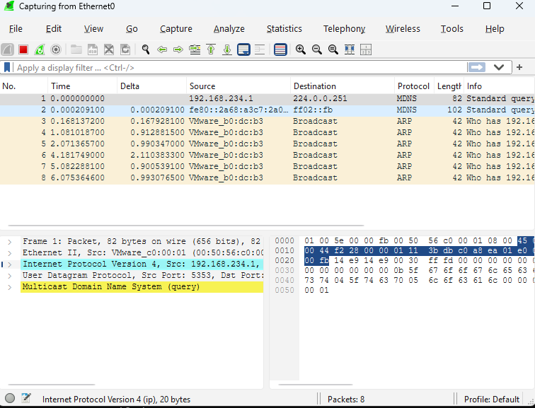

Now lets commence the attack on our Linux VM

<span style="color:red;">*(See Hydra attack initiated below)*</span>
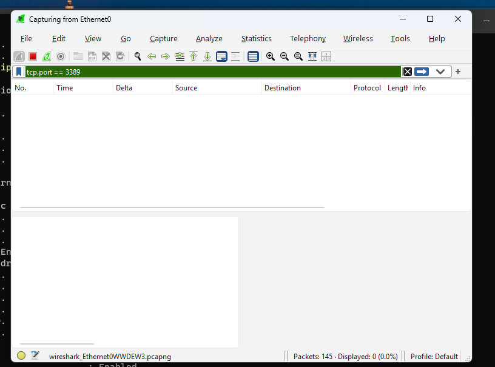

And just as the attack happened our rdp port being monitored on wireshark suddenly got a surge of traffic.

<span style="color:red;">*(See traffic surge below)*</span>
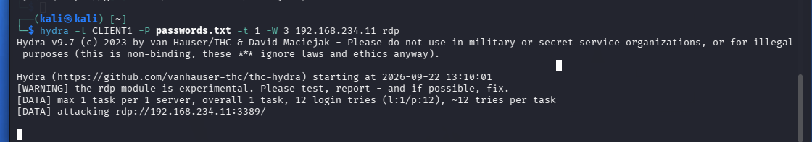

Alright, now there is a lot to unpack here. Let's start with the obvious ones which are the time, source, and destination columns. The time is when the packet was captured, source is where it came from in our case it's the ip address of the kali vm (attacker), destination is where its going (the victim client).

We also see familiar terms on the info section such as the SYN, SYN-ACK, ACK or the three way handshake. Go gain better clarity on this we'll be using another filter.
tcp.flags.syn == 1 && tcp.flags.ack == 0
The reason we will be using this filter is we can specifically capture the packets from when the attacker tries to establish a connection. Our objective in using this filter is to identify how many times the attacker tried to establish a connection, in doing so we will be able to determine if it's just a false positive from a person forgetting or doing typos when inputting their password or if its from an automated tool which would send a barrage of requests on a short timespan.

<span style="color:red;">*(See TCP SYN filter results below)*</span>
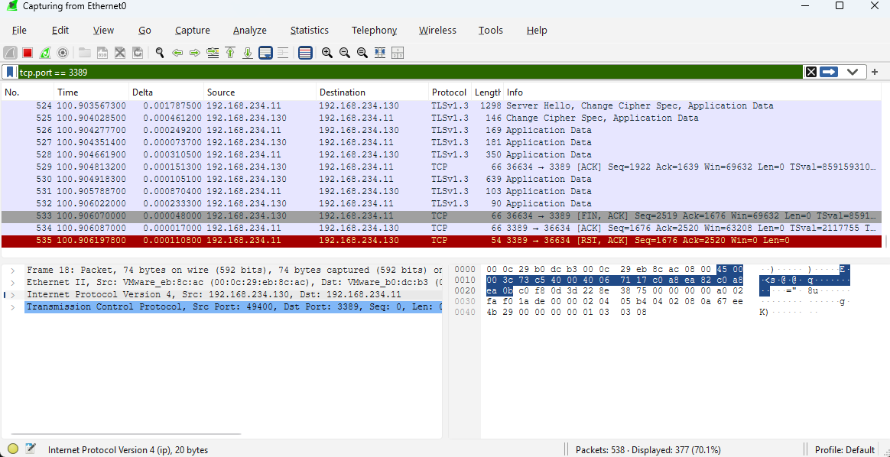
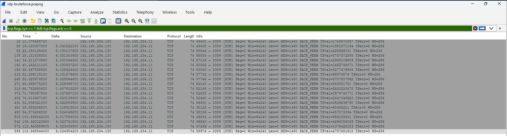

Here we can see the results of the filter we created. Both images are the same results I just changed the formatting of the time so I can understand it better. The top image displays the time in seconds when the packet was first captured.
The key finding here is that during that short timeframe which is around 118 seconds or nearly 2 minutes in we had a client try to establish connection 20 times. It's also good to note the gap between each connection attempt is around 6 seconds, so everytime the connection attempt fails a new attempt is automatically made every 6 seconds.

From here we can deduce that this patter is consistent with the behavior of automated tools such as a brute force tool like hydra. Why? Other than the massive number of attempts on a short amount of time (20 attempts in less than 2 minutes) we can also see the gap between each attempt is consistently 6 seconds, which we can't attribute to normal user behavior. This type of consistency can only be attributed to the characteristics of tools or bots. It's also important to note that all connection attempts came from the same source IP meaning that what we have is a single attacker rather than distributed traffic.

Now lets use another filter which will also give us the same results, but this filter is used specifically to see how many times did the attacker star a new encrypted RDP session. Although this will has the same concept from the previous comment this specifically is for when we want to confirm if the brute force is happening on the application layer  (RDP/TLS) rather than just at the tcp layer
tls.handshake.type == 1
Through the use of the tls.handshake.type == 1 filter we can see the initial message of every TLS handshake which happens whenever the attacker or another clients requests for an encrypted session. We can see "Client Hello" on the "Info" tab, which is what we put on the filter type:1 as 1 is the numeric code for client hello specifically. So just like the previous filter we used we are also able to identify here that the attacker tried to request an encrypted session 20 times over the span of 2 minutes.We can also see more information that will help us with our investigation by using the statistics tab on wireshark.

<span style="color:red;">*(See TLS handshake filter results below)*</span>
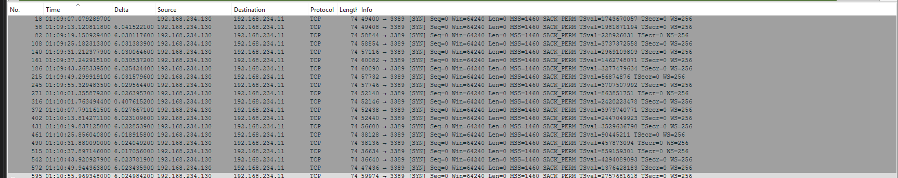

Here we have the Conversations tool and I/O graph from the statistics tab. From the conversations tool we can see the same IP targeting the same port. And from the I/O graph we can see 20 spikes which are consistent with the brute force attempt of the attacker we observed from our filters earlier, its important to note that everything we see in the graph are all spikes which is akin to how an automated brute force tool would behave.

<span style="color:red;">*(See Wireshark statistics Conversations and I/O Graph below)*</span>
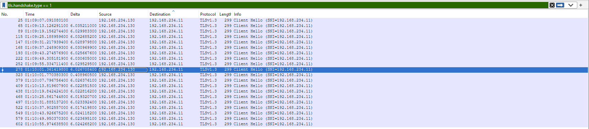
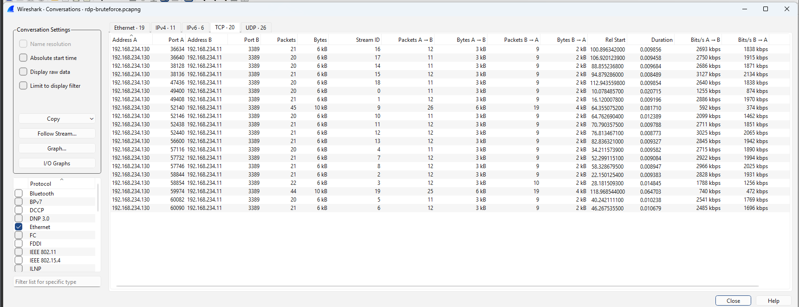

Now that we observed and identified that we are being brute forced from a network how do we actually see if they succeeded? Well we can check it through our Splunk of course as through the use of Sysmon and universal forwarded or event logs are automatically transported there. But in this case we can check it on Event Viewer. If we filter it by using the Event ID "4625" which is the event id for failed logins and correlate it with what we found in wireshark the 6 second gap before every attempt we can identify when it happened and then check using Event ID "4624" if the logon succeeded.

<span style="color:red;">*(See Event viewer 4625 failed logins below)*</span>
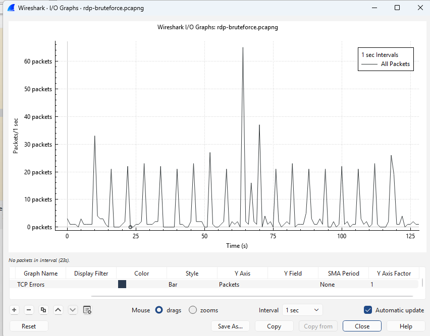

Here we can see the attempts all failing, but now if we check using the Successful event ID we can identify if the attacker succeeded in their brute force attempt. The key is to look at the time and correlate the events that happened.The one highlighted which happened on 1:10:55AM correlates to when the attack happened and among all attempts this was the only one that passed, if you remember on the failed attempts the last failed attempt was during 1:10:49AM now 6 seconds after that and we get the timestamp of the successful login attempt, we can conclude that the attacker has successfully been able to brute force the device. And with the conclusion we now have we can act and put up security measures such as blocker the attackers ip, disabling the compromised account, or even better create a precautionary measure that locks out an account after a set number of failed attempts.

<span style="color:red;">*(See Event viewer 4624 successful login below)*</span>
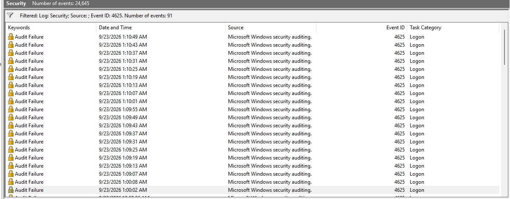
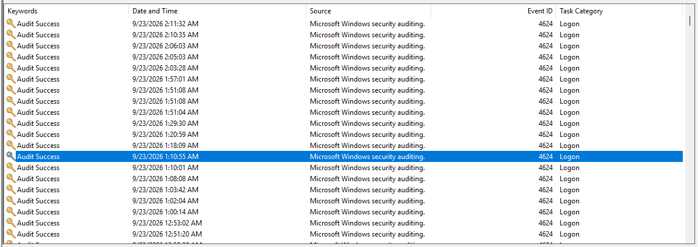

On a side note, its important to know that in the event logs we can only see 19 logs 18 which failed and 1 which succeeded, we are missing 1. And this can be explained by the way hydra behaves, usually the first connection that hydra created is just the initial probe which tests if the port is open before it actually does any brute force attempts. That did not appear on the windows event viewer but wireshark was able to catch it as SYN which is why in wireshark we saw 20.


## Phase 5: Creating alerts instead of relying on manual searches

Using the result from Phase 4, save the search query as an alert. Either the time-bucketed version, or a simpler version that doesn't use time:

```
index=* source="WinEventLog:Security" EventCode=4625
| stats count by host
| where count > 5
```

On the top right of the search, save the query as an alert, and add a title and description.

**MITRE ATT&CK mapping —** T1110 is the technique associated with brute-force attacks. This includes:

- T1110.001: Password Guessing
- T1110.002: Password Cracking
- T1110.003: Password Spraying
- T1110.004: Credential Stuffing

Set the **time range to Last 5 minutes** — the alert runs every 5 minutes and looks at all failed logons within that timeframe that exceeded 5 attempts. The "more than 5" condition comes from the saved search query (`| where count > 5`).

For **trigger actions**, we used "Add to Triggered Alerts" — every time the alert fires, we can see it in the Triggered Alerts section.

### Testing the alert

Back on the Kali VM, simulate a brute-force attack on the RDP of CLIENT1 again using Hydra. Then return to the Splunk SIEM and check whether the alert caught the attempt.

In the Alerts tab we can see the alert caught a possible brute-force attempt. Expanding it with **View Results** shows what the alert found: the monitored client recorded 9 failed attempts within 5 minutes.


### Detection summary

| Detection | Data source | Logic (SPL) | MITRE ATT&CK |
|-----------|-------------|-------------|--------------|
| RDP / logon brute force | `WinEventLog:Security` (EventCode 4625) | `stats count by host \| where count > 5` (rolling 5-min window) | T1110 — Brute Force |

---

## Notifying an analyst — Discord webhook integration

Instead of manually checking the Triggered Alerts tab, we push notifications automatically via a webhook. For this scenario, Discord receives the triggered alerts from Splunk.

First, get a webhook from your Discord channel. Then, in Splunk, edit the alert.

Here we use the **Run a script** action, because a direct Splunk-to-Discord webhook is unreliable — Discord requires a `content` field. So we still use the webhook, but through a script that sends the alert to our Discord channel.

The script:

```bat
curl -H "Content-Type: application/json" -d "{\"content\": \"Possible RDP Brute Force detected on your monitored host\"}" "<YOUR_DISCORD_WEBHOOK_URL>"
```

Dissecting the script:

- **`curl`** — also known as client URL, a command-line tool that sends web requests. In our case it sends data to Discord through our webhook.
- **`-H "Content-Type: application/json"`** — the header, telling Discord that the content we're sending is in JSON format. This is needed so Discord knows how to read the message.
- **`-d "{...}"`** — the data we're sending: the content we want to appear in Discord from our Splunk SIEM. The `content` field holds whatever text Discord displays.
- The format looks the way it does because **JSON requires a "key": "value" pair**, wrapped in curly brackets — `{"key": "value"}`. In our case that's `{"content": "Possible RDP Brute Force detected..."}`.
- The multiple **backslashes** are used to escape the quotation marks. Because the JSON (which uses quotes) is nested inside curl's own quoted `-d` argument, each inner quote must be escaped with `\` so it's treated as a literal character and the command runs correctly. (The URL keeps plain quotes because it isn't nested inside another quoted string.)

### Wiring the script into the alert

1. Create a `.bat` script in Splunk's `bin\scripts` folder (`C:\Program Files\Splunk\bin\scripts` — create the `scripts` folder if it doesn't exist).
2. In the alert's trigger actions, select **Run a script** and choose the `.bat` file you just made.

Once set up, you receive a message on your Discord, and you now have a fully working alert notification system.

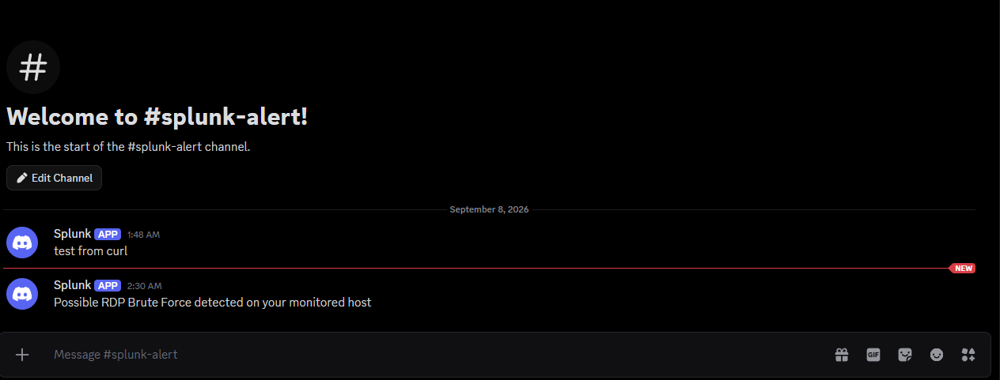

---

## <span style="color:red;">Expanding detections and documenting incidents</span>

Lets add more on to what we currently have, it’s a good start but there is still more room for improvement and growth. Let’s start by implementing more detection rules to generate better and fine-tuned alerts that will help us with triaging incidents.

<span style="color:red;">The lab now covers six controlled scenarios. Each incident report records the detection, analysis, indicators and response considerations.</span>

| Incident | MITRE ATT&CK |
|---|---|
| [IR-2026-001 - RDP Brute Force with Successful Logon](docs/updated-lab-documentation.md#incident-report-ir-2026-001---rdp-brute-force-with-successful-logon) | T1110 |
| [IR-2026-002 - Unauthorized Local Account Creation](docs/updated-lab-documentation.md#incident-report-ir-2026-002---unauthorized-local-account-creation) | T1136.001 |
| [IR-2026-003 - Unauthorized Administrator Addition](docs/updated-lab-documentation.md#incident-report-ir-2026-003---unauthorized-administrator-addition) | T1098 |
| [IR-2026-004 - Script Interpreter Spawning Shell](docs/updated-lab-documentation.md#incident-report-ir-2026-004---script-interpreter-spawning-shell) | T1059.005 |
| [IR-2026-005 – Encoded Powershell](docs/updated-lab-documentation.md#incident-report-ir-2026-005--encoded-powershell) | T1059.001 |
| [IR-2026-006 – Windows Even Log Cleared](docs/updated-lab-documentation.md#incident-report-ir-2026-006--windows-even-log-cleared) | T1070.001 |

### <span style="color:red;">RDP brute force with successful logon</span>

```spl
index=* source="WinEventLog:Security" (EventCode=4624 OR EventCode=4625)
| stats
    sum(eval(if(EventCode=4625, 1, 0))) as failures,
    sum(eval(if(EventCode=4624, 1, 0))) as successes
    by Account_Name, host
| where failures > 5 AND successes > 0
```

<span style="color:red;">The search counts failed and successful logons for each account and host, retaining groups with more than five failures and at least one success. Verify time order, source address and logon type in the raw events when investigating.</span>

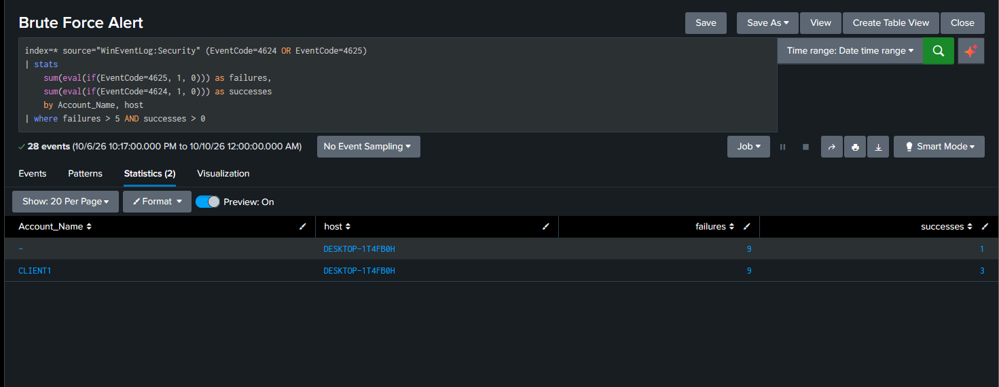

### <span style="color:red;">New local account creation</span>

```spl
index=* source="WinEventLog:Security" EventCode=4720
| rex field=Message "New Account:\s+Security ID:\s+\S+\s+Account Name:\s+(?P<Target_User_Name>\S+)"
| rex field=Message "Subject:\s+Security ID:\s+\S+\s+Account Name:\s+(?P<Subject_User_Name>\S+)"
| table _time, host, Target_User_Name, Subject_User_Name
```

In testing the functionality of the alert we’ll be creating a user account on the compromised client (DESKTOP-1T4FB0H) which will simulate the attacker creating a backdoor account to maintain access to the system even if the original compromised account (CLIENT1) is disabled or the password is reset.

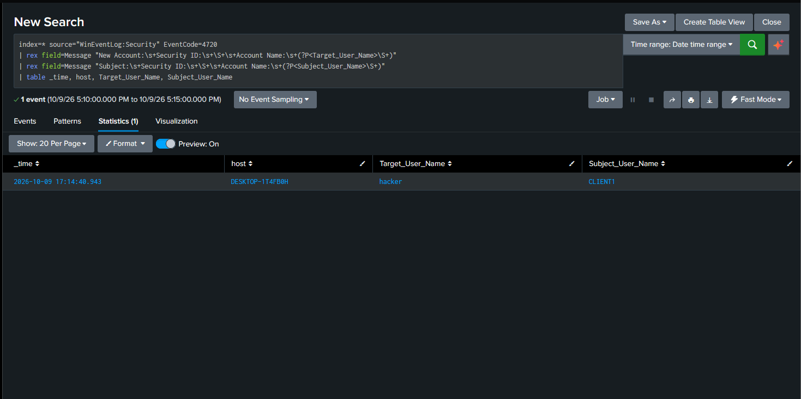

### <span style="color:red;">Administrator group membership changes</span>

```spl
index=* source="WinEventLog:Security" EventCode=4732
| rex field=Message "Member:\s+Security ID:\s+(?P<Member_SID>S-1-\S+)"
| rex field=Message "Subject:\s+Security ID:\s+\S+\s+Account Name:\s+(?P<Subject_User_Name>\S+)"
| rex field=Message "Group:\s+Security ID:\s+\S+\s+Group Name:\s+(?P<Group_Name>\S+)"
| where Group_Name="Administrators"
| table _time, host, Member_SID, Subject_User_Name, Group_Name
```

<span style="color:red;">The test adds a local account to Administrators, then checks who performed the change and which account received membership.</span>

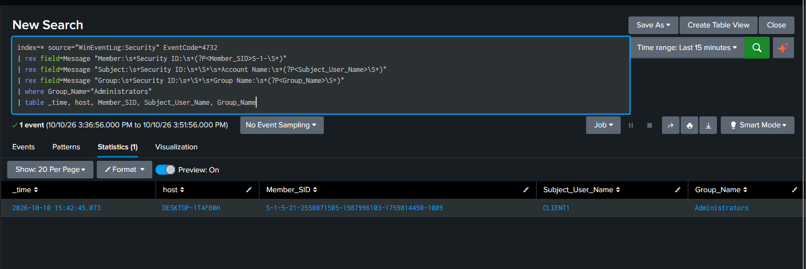

### <span style="color:red;">Script interpreter spawning a shell</span>

```spl
index=main source="WinEventLog:Microsoft-Windows-Sysmon/Operational"
```

<span style="color:red;">The controlled WScript test launches cmd.exe. Investigate the parent process and command line before treating similar activity as malicious in a real environment.</span>

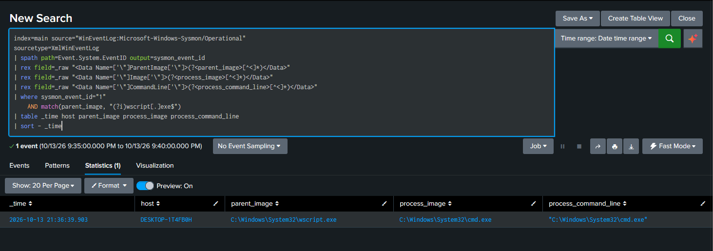

### <span style="color:red;">Encoded PowerShell</span>

```spl
index=main source="WinEventLog:Microsoft-Windows-Sysmon/Operational"
```

<span style="color:red;">The test uses an encoded Write-Host Hello command. Base64 is encoding, not encryption; the encoded argument alone does not prove malicious intent.</span>

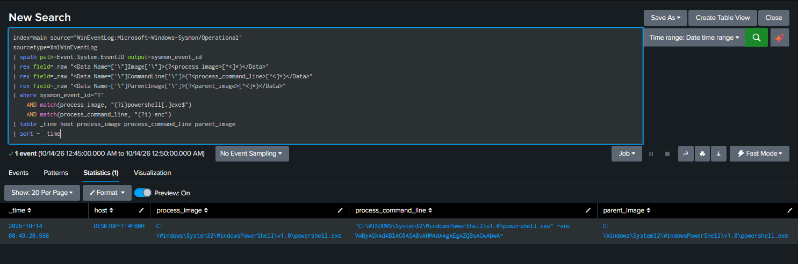

### <span style="color:red;">Windows Security log cleared</span>

```spl
index=* source="WinEventLog:Security" EventCode=1102
| table _time, host, Message
```

<span style="color:red;">EventCode 1102 identifies the Security log being cleared. Previously forwarded events remain available in Splunk, providing evidence beyond the endpoint.</span>

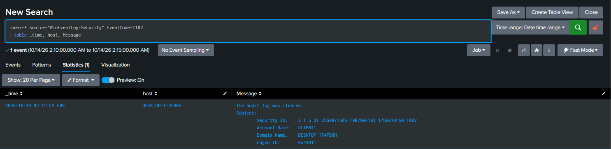

---

## <span style="color:red;">Wazuh Active Response — marker test</span>

<span style="color:red;">With endpoint events reaching Splunk, the next step was to test response execution. Wazuh runs on the Ubuntu manager, while its Windows agent runs the response scripts on the monitored endpoint.</span>

| Component | Machine | Purpose |
|---|---|---|
| `lab-marker.ps1` | Windows endpoint `192.168.234.11`, agent `001` | Writes the signature or the one that leaves the marker |
| `lab-marker.cmd` | Same Windows endpoint | it’s the one that starts the .ps1 script |
| `ossec.conf` | Ubuntu manager `192.168.234.132` | this is what tells wazuh when to request the marker |

### <span style="color:red;">Creating the marker script</span>

<span style="color:red;">On the Windows endpoint, save the following as C:\Program Files (x86)\ossec-agent\active-response\bin\lab-marker.ps1.</span>

```powershell
$ErrorActionPreference = 'Stop'
$message = [Console]::ReadLine() | ConvertFrom-Json
if ($message.command -ne 'add') { exit 0 }
$record = [ordered]@{
    time = [DateTime]::UtcNow.ToString('o')
    action = 'marker'
    rule = $message.parameters.alert.rule.id
    result = 'executed'
}
$record | ConvertTo-Json -Compress | Add-Content -LiteralPath "$PSScriptRoot\..\lab-marker.jsonl"
```

<span style="color:red;">The script reads the JSON message from Wazuh, accepts an add command and appends the execution time, rule ID and result to lab-marker.jsonl. The output file is one folder above bin, in active-response; each execution adds a line to the same file.</span>

### <span style="color:red;">Creating the launcher</span>

<span style="color:red;">Save lab-marker.cmd beside the PowerShell script on the Windows endpoint.</span>

```bat
@echo off
"%SystemRoot%\System32\WindowsPowerShell\v1.0\powershell.exe" -NoProfile -NonInteractive -ExecutionPolicy Bypass -File "%~dp0lab-marker.ps1"
```

The job of this .cmd file is to start powershell and ask it to run our marker script (.ps1 file)

### <span style="color:red;">Connecting the response to a detection</span>

<span style="color:red;">On Ubuntu, add the command and response blocks inside ossec_config in /var/ossec/etc/ossec.conf. Rule 92002 was observed for the WScript test; agent 001 is the endpoint ID, not the detection rule ID.</span>

```xml
<command>
  <name>lab-marker</name>
  <executable>lab-marker.cmd</executable>
  <timeout_allowed>no</timeout_allowed>
</command>

<active-response>
  <disabled>no</disabled>
  <command>lab-marker</command>
  <location>local</location>
  <rules_id>92002</rules_id>
</active-response>
```

<span style="color:red;">Validate the configuration, then restart the manager only if validation succeeds.</span>

```bash
sudo /var/ossec/bin/wazuh-analysisd -t
sudo systemctl restart wazuh-manager
```

### <span style="color:red;">Testing the response</span>

<span style="color:red;">Run the WScript test again on the Windows endpoint. Inspect the new alert on Ubuntu and the corresponding Splunk result.</span>

```bash
sudo tail -f /var/ossec/logs/alerts/alerts.json
```

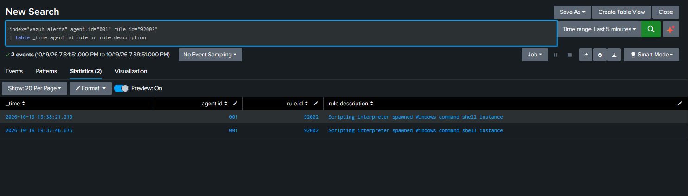

<span style="color:red;">On the Windows endpoint, read the last five marker records:</span>

```powershell
Get-Content 'C:\Program Files (x86)\ossec-agent\active-response\lab-marker.jsonl' -Tail 5
```

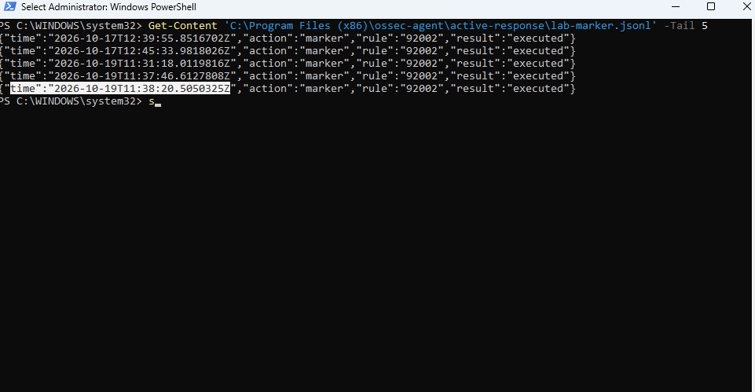

<span style="color:red;">A new record with rule 92002 confirms that the marker executed. The timestamps use UTC. This validates a native Wazuh response; it does not demonstrate a Splunk-triggered action or containment.</span>

---

## <span style="color:red;">API-triggered response from the Splunk VM</span>

<span style="color:red;">After validating the native response, the next test requests the same marker through the Wazuh API from PowerShell on the Splunk VM. This request is manual; a Splunk alert does not yet initiate it.</span>

| Step | Configuration |
|---|---|
| <span style="color:red;">HTTPS</span> | <span style="color:red;">Created a lab CA and signed an API server certificate for 192.168.234.132.</span> |
| <span style="color:red;">Certificate trust</span> | <span style="color:red;">Configured api.yaml on Ubuntu and copied only the public CA certificate to C:\Lab\wazuh-lab-ca.pem on the Splunk VM.</span> |
| <span style="color:red;">Authentication</span> | <span style="color:red;">Logged in to the API and obtained a temporary token.</span> |
| <span style="color:red;">Permissions</span> | <span style="color:red;">Created splunk-response and linked its role to agent:read and active-response:command permissions for agent 001.</span> |
| <span style="color:red;">Verification</span> | <span style="color:red;">Requested lab-marker0 and checked for a new lab-api-test record on the endpoint.</span> |

### <span style="color:red;">Checking connectivity and authenticating</span>

<span style="color:red;">Run these commands in PowerShell on the Windows Splunk VM, 192.168.234.10. Use the password chosen for splunk-response when prompted. The target endpoint must be online and agent 001 must be Active.</span>

```powershell
$apiBase = 'https://192.168.234.132:55000'
$caFile = 'C:\Lab\wazuh-lab-ca.pem'
$agentId = '001'
Test-NetConnection 192.168.234.132 -Port 55000
```

```powershell
$apiToken = curl.exe --ssl-revoke-best-effort --fail --silent --show-error --cacert $caFile --user 'splunk-response' -X POST "$apiBase/security/user/authenticate?raw=true"

if ($LASTEXITCODE -ne 0 -or [string]::IsNullOrWhiteSpace($apiToken)) {
    throw 'Automation account login failed. Stop here.'
} else {
    Write-Host 'Automation account login succeeded.'
}
```

```powershell
curl.exe --ssl-revoke-best-effort --fail --silent --show-error --cacert $caFile "$apiBase/agents?agents_list=$agentId" -H "Authorization: Bearer $apiToken"
```

<span style="color:red;">The Windows curl commands use --ssl-revoke-best-effort because this lab CA does not publish revocation information. CA trust, certificate validity and server-address checks remain enabled. A 401 reply requires checking authentication, including whether the token expired.</span>

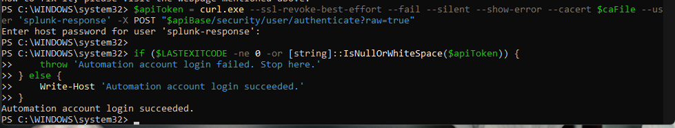

### <span style="color:red;">Building and sending the marker request</span>

```powershell
$body = @{
    command = 'lab-marker0'
    arguments = @()
    alert = @{
        rule = @{
            id = 'lab-api-test'
        }
    }
} | ConvertTo-Json -Depth 8
```

```powershell
$bodyFile = Join-Path $env:TEMP 'wazuh-marker-request.json'

[IO.File]::WriteAllText(
    $bodyFile,
    $body,
    [Text.UTF8Encoding]::new($false)
)
```

<span style="color:red;">The body selects the registered lab-marker0 response. The label lab-api-test makes the resulting marker distinguishable from the detection-triggered test; it is not a new detection rule.</span>

```powershell
curl.exe --ssl-revoke-best-effort --fail --silent --show-error --cacert $caFile -X PUT "$apiBase/active-response?agents_list=$agentId" -H "Authorization: Bearer $apiToken" -H 'Content-Type: application/json' --data-binary "@$bodyFile"
```

<span style="color:red;">The request explicitly targets agent 001. Inspect error and total_failed_items in the API response, then verify the actual endpoint output.</span>

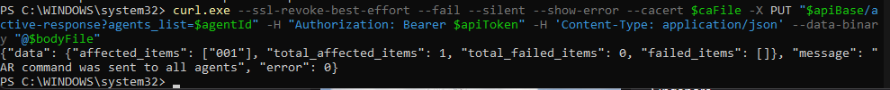

### <span style="color:red;">Verifying execution on the endpoint</span>

```powershell
Get-Content 'C:\Program Files (x86)\ossec-agent\active-response\lab-marker.jsonl' -Tail 5
```

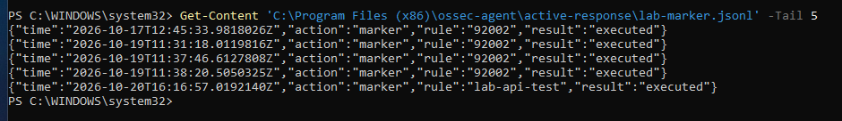

And there we have it, the lab api test we made specifically as the label for our test officially made it through.

<span style="color:red;">The new lab-api-test entry confirms endpoint execution after the manual API request. Automatic response requests from Splunk alerts are the next stage.</span>

---

## Key takeaways

This lab demonstrates a complete detection workflow end to end: collecting endpoint telemetry (Sysmon + Windows Event Logs), forwarding it to a SIEM, writing detection logic in SPL, distinguishing an automated attack from normal user behaviour (time-clustered failure volume, not raw counts), turning that logic into a scheduled alert mapped to MITRE ATT&CK (T1110), and routing the notification to where an analyst would see it. It reflects the core skills behind SOC detection and monitoring, built hands-on in an isolated lab. <span style="color:red;">The later stages add evidence-based incident reports, native Wazuh marker execution and a manually authenticated API request from the Splunk VM to agent 001.</span>

---

## ⚠ Security & scope note

All attacks in this lab were performed against machines I own, inside an isolated host-only virtual network. Brute-force tooling should only ever be used against systems you have explicit permission to test. The Discord webhook URL in this documentation is a placeholder — the real URL is a live credential and is not committed to this repository.
