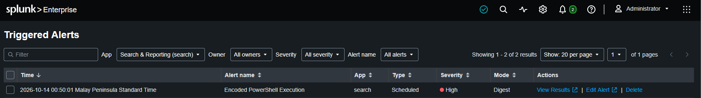
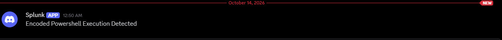

# Incident Report: IR-2026-005 – Encoded Powershell

Related incidents: 

IR-2026-001 - RDP Brute Force (attacker gained initial access via CLIENT1) –

IR-2026-002 - Unauthorized Local Account Creation (backdoor account established for persistent access) 

IR-2026-003 - User Added to Administrators (attacker gained full system control before executing this script)

IR-2026-004 - Script Interpreter Spawning Shell (attacker established command execution before running encoded PowerShell)

Severity: High | Status: Contained | MITRE: T1027 — Obfuscated Files or Information / T1059.001 — PowerShell 

Alert Details

• Alert name: Encoded PowerShell Execution

• Triggered: 00:50:01 / 12:50AM

• Monitored host: DESKTOP-1T4FB0H

• Affected account: CLIENT1

### Timeline (UTC+8)

| Time | Event |
| --- | --- |
| 00:49:20.568 / 12:49AM | PowerShell executed with -enc flag |
| 00:49:20.568 / 12:49AM | Sysmon EventCode 1 recorded |
| 00:50:01 / 12:50AM | Alert fires, Discord notification received |
| 00:50:01 / 12:50AM | Response actions performed manually |

### Detection

SPL query that triggered this alert:

```spl
index=main source="WinEventLog:Microsoft-Windows-Sysmon/Operational"
sourcetype=XmlWinEventLog
| spath path=Event.System.EventID output=sysmon_event_id
| rex field=_raw "<Data Name=['\"]Image['\"]>(?<process_image>[^<]*)</Data>"
| rex field=_raw "<Data Name=['\"]CommandLine['\"]>(?<process_command_line>[^<]*)</Data>"
| rex field=_raw "<Data Name=['\"]ParentImage['\"]>(?<parent_image>[^<]*)</Data>"
| where sysmon_event_id="1"
    AND match(process_image, "(?i)powershell[.]exe$")
    AND match(process_command_line, "(?i)-enc")
| table _time host process_image process_command_line parent_image
| sort - _time
```

Results:
- Host: DESKTOP-1T4FB0H
- Parent Image: C:\Windows\System32\WindowsPowerShell\v1.0\powershell.exe
- Process Image: C:\Windows\System32\WindowsPowerShell\v1.0\powershell.exe
- Process Command Line:  "C:\WINDOWS\System32\WindowsPowerShell\v1.0\powershell.exe" -enc VwByAGkAdABlAC0ASABvAHMAdAAgAEgAZQBsAGwAbwA=






### Analysis

The SPL Query engineered monitors Sysmon process creation events which correspond to (EventCode 1) which we use as a basis to detect when powershell gets executed with -enc (EncodedCommand) flag which allows powershell to accept base64 encoded commands as input rather than plain text. Although most of the time this isn’t an immediate sign of an attacker executed script, but its good to know that legitimate powershell usage rarely requires encoding. Most attackers use this to obfuscate their commands and evade basic detection which look for suspicious keywords observable in plain text. Decoding the Base64 string is a critical step in determining the full scope of what was executed on the compromised system.

### Indicators of Compromise (IOCs)

| Type | Value |
| --- | --- |
| Target host | DESKTOP-1T4FB0H |
| Parent Process | powershell.exe |
| Flag used | -enc |
| Encoded cmd | VwByAGkAdABlAC0ASABvAHMAdAAgAEgAZQBsAGwAbwA= |
| Decoded cm | Write-Host Hello |

### Response Actions Taken

Note: This environment currently consists of a SIEM only. The following response actions would be performed manually upon alert trigger.

1. Kill the powershell process:

taskkill /IM powershell.exe /F

2. Decode the command to determine what was executed:

[Text.Encoding]::Unicode.GetString([Convert]::FromBase64String($encoded))

3. Investigate ParentImage to determine what launched PowerShell

### Verdict

Confirmed obfuscated command execution. Powershell was launched with a Base64 encoded command with the -enc flag this technique is often used by attackers to hide their malicious commands from log inspection. Decoding the Base64 string reveals the actual command which was executed. However, it is important to note that -enc usage is not often definite proof of malicious intent or proof of an attack. Attack scenario was simulated in an isolated lab environment.

### Limitations &amp; Recommendations

Response was performed manually as the environment consists of a SIEM only with no EDR or XDR. An EDR would automatically block encoded PowerShell based on behavioural rules. 

Recommendation: Enable PowerShell Script Block Logging via Group Policy — this automatically logs the decoded command regardless of encoding, making the -enc obfuscation technique completely ineffective.

<span style="color:red;">Review: this report preserves the source document wording. Its response and recommendation sections describe the earlier lab stage and must not be read as proof of completed automated containment.</span>

## <span style="color:red;">Detection evidence</span>


[← <span style="color:red;">Back to the lab walkthrough</span>](../../README.md)
