# My Splunk Homelab Documentation

## Phase 1: Installing

Self Explanatory just install then login into port 8000 in your preferred web browser, and sign in using the credentials you made when downloaded splunk enterprise.

## Phase 2: Installing the pre-built pile of security logs I can study BOTSV3 (Boss of the SOC v3)

Look for the BOTSv3 repository on github and install it

After installing install it as an app on your splunk. 

### Learnings from Phase 2:

	To identify all the sourcetypes we can just use the search bar to look up all the sourcetypes. Using index=”your index” | stats count by sourcetype | sort – count

This will search our index and count the sourcetypes we have in our index and sort it in descending order. So the sourcetype with most events logged will be on top.

Some sourcetypes are self explanatory such as linux_secure and WinEventLogs but most names often hint at their source, but in order to further actually see what they are or what they contain inspect their raw event or look them up.

ReverseMapping and ForwardMapping

ReverseMapping uses the IP to ask DNS for the hostname connected to.

ForwardMapping using the hostname it got from reverse mapping it then asks DNS what IP the hostname is linked to or what it points to validate if they truly match.

Verdict a failed FRcDNS (Forward Confirmed Reverse DNS) is not often a sign of compromise but it is considered by some as a minor flag.

If you don’t know what field to look for you can use the fieldsidebar on the left side.

The workflow is always discover -&gt; confirm -&gt; query

The host field is usually the victim not the attacker. The constant value e.g contant ip in any event is most likely always the machine that is writing the logged.

## Phase 3: 

### 	Sysmon

SysMon is a free Microsoft Sysinternals tools which logs detailed system activities on the windows operating system such as process creation, network connections, and any changes withing files or the registry. which windows does not normally record by default. So basically, we use sysinternals so we can get logs or event information from the client being monitored by splunk, the information logged by Sysmon will be forwarded using the universal forwarder to splunk for monitoring. 

Installed SysMon (Microsoft Sysinternals) and “SwiftOnSecurity sysmon-config”

Afterwards, add a new receiving port on your splunk vm, add 9997 as the new receiving port so you can receive forwarded logs on that port.  

Install splunk universal forwarder on the machine you want or will be monitoring in splunk, proceed to setup the universal forwarder. After installing go to  C:\Program Files\SplunkUniversalForwarder\etc\system\local to create an inputs.conf file  with the contents being:

```ini
   [WinEventLog://Security]
   disabled = 0
   [WinEventLog://Microsoft-Windows-Sysmon/Operational]
   disabled = 0
```

dunking the inputs.conf file:

[WinEventLog://Security] and [WinEventLog://Microsoft-Windows-Sysmon/Operation]

These are called stanza headers and these define an input. Inputs are where we get our data from, it’s a source of data to collect hence why its input. WinEventLog:// is the input type its what tells the splunk forwarder what to read so for this instance it tells the forwarder to read the WinEventLog:// and the Security right next to it specifies which specific Event Log to read. 

install splunk app “splunk add on for Sysmon” if everything is done correctly you can now use the index=* command on the search bar to see if the machine you just added provides or forwards you with new security events.


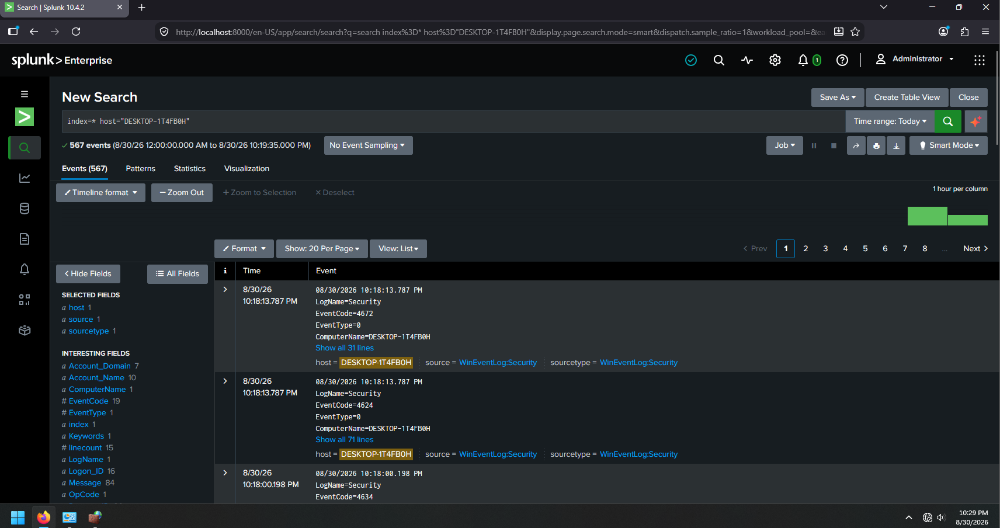

## Phase 4: Attacking the Client being monitored to generate logs’

The attack command: hydra -l &lt;username&gt; -P &lt;password-list&gt; &lt;target-ip&gt; &lt;service&gt;

Breaking down the hydra command section by section and identifying what each command does. 

-l this means “exact username” so this we will use when we know what the username of the client to be attacked is -L is used when we want the attack to use a list of possible usernames from the file. Rather than -l then followed by &lt;username&gt;. -L will be followed by the &lt;file&gt;

-P &lt;password-list&gt;

	- this refers to our payload or our file with the list of passwords that hydra will use to attack the target client. This will be what our brute force will us. Alternatively, is we use the -p (the lowercase version) it will only use 1 password for guessing.
&lt;target-ip&gt; (self explanatory)

&lt;service&gt;

Here we will put which protocol to attack, either rdp (remote desktop) or smb (server message block) btw, server message block is the protocol for sharing files with other devices within the same network. 

Afterward lets create a password.txt file which will serve as our payload in here we will input the false password along with the correct password so can we generate logs within splunk and see the effects of brute force on a client being monitored by splunk.

Now conducting the attack using what we’ve learned.

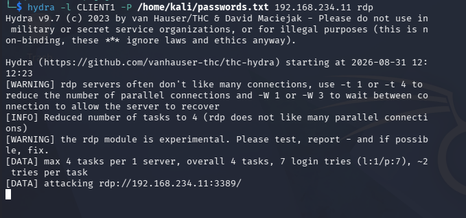

Results of the attack:

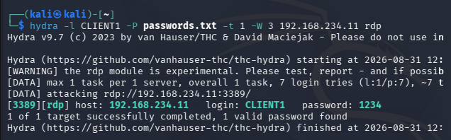

Splunk index Result:

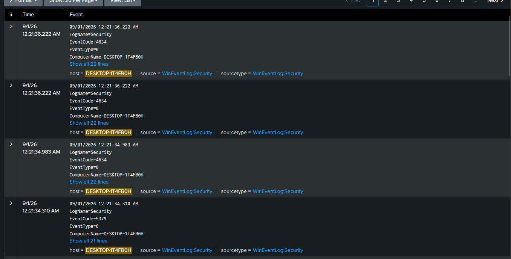

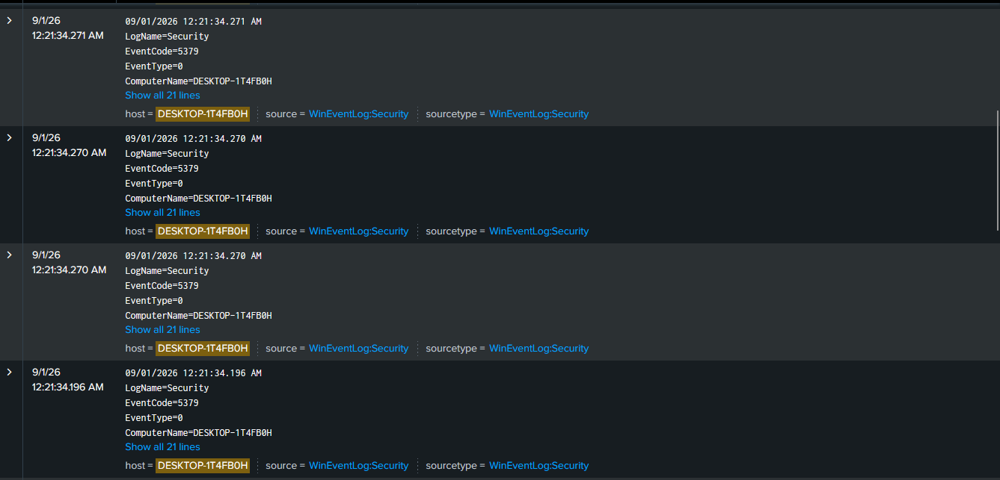

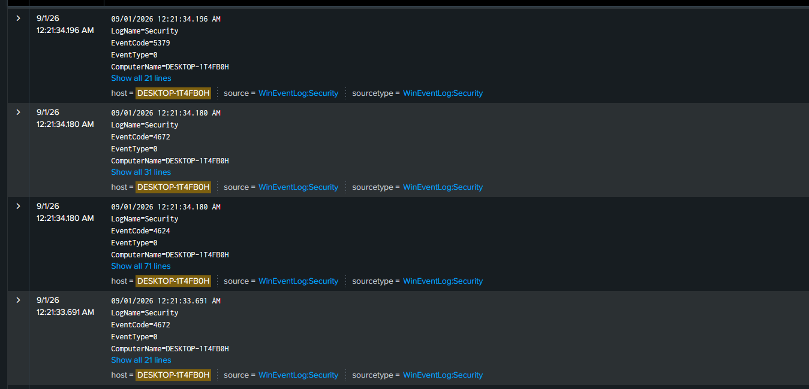

Error code notes:

4634 – account logoff

5379 - This event occurs when a user performs a read operation on stored credentials in Credential Manager.

4672 – special privileges assigned to new logon. This tells us that the account that just logged in has admin level privileges 

4624 – successful account logon

4625 – unsuccessful account logon

Conclusion formed: If we were to read the different events in the correct order, we can see from the events that there were numerous failed attempts at trying to login onto client1 after a few attempts someone has successfully logged on into Client1 someone with privileged permissions as we can see from the 4624+4672 event codes. Then proceeded to do checking stored credentials, then logged off shortly afterwards.

By this we can conclude that this does not resemble a user login as the once the “user” logged off shortly afterwards which does not resemble a human doing work at his desk. This reflects the action of hydra wherein it tested multiple passwords and once it returned with a successful login, it dropped the session.

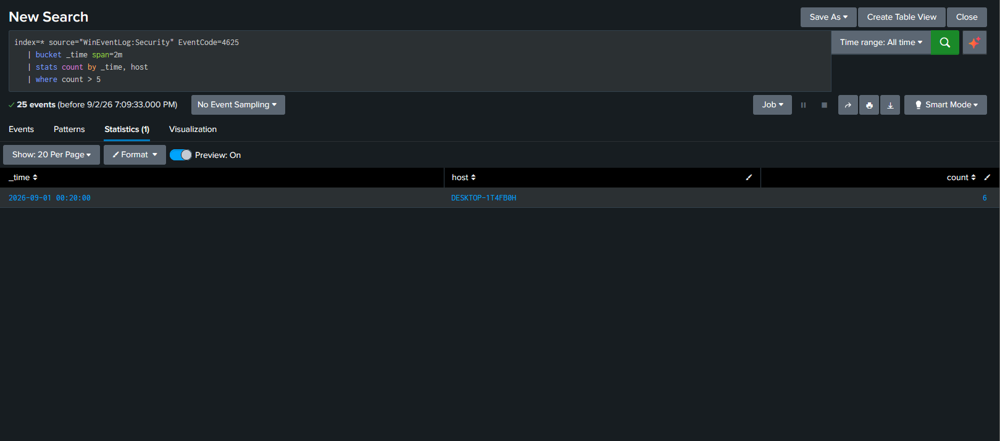

Above are the results from using the search query:
   index=* source="WinEventLog:Security" EventCode=4625

   | bucket _time span=2m

   | stats count by _time, host

   | where count &gt; 5
Lets dissect the search query we used.    
index=* source="WinEventLog:Security" EventCode=4625

 we choose our index, the source, the the corresponding eventcode that reflects failed logins.


| bucket _time span=2m

What bucket does is group up all the events depending on the condition you set, in this case we used time span=2m along with bucket which means that all happened which happened around the span of 2 minutes are grouped together thus we can see we only got 1 result, if bucket were not used those events would be displayed separately

   | stats count by _time, host

Displays the events statistically by sorting them by their count and host.

   | where count &gt; 5

Where the count which we used in the 2nd pipe is greater than 5.


Conclusion from this:
In a span of 2 minutes there have been more than 5 failed attempts at logging in to our specifically 6 attempts within the span of 2 minutes or less. This does not resemble a human failed login, 6 failed password attempts in the span of 2 minutes does not seem humanly possible unless if a user intentionally spammed wrong passwords. 

Phase 5: Creating alerts rather than relying on manual searches.

Using the result we got on phase 4 by using the searcy query:
index=* source="WinEventLog:Security" EventCode=4625

| bucket _time span=2m

| stats count by _time, host

| where count &gt; 5

Or by using a different query which doesn’t make use of the time
index=* source="WinEventLog:Security" EventCode=4625

| stats count by host

| where count &gt; 5


Now on the top right of the search query lets save the search query as an alert

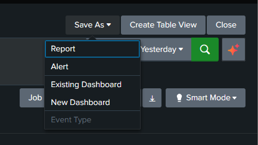

Add the following as the title and description

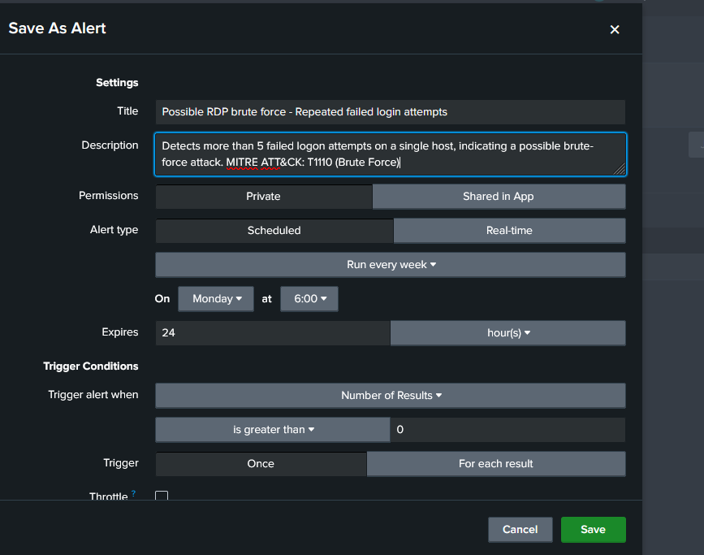

Note: MITRE ATT&amp;CK: T110 is the id associated with brute force attacks this includes:

T110.1: Password Guessing

T110.2: Password Cracking

T110.3: Password Spraying

T110.4: Credential Snuffing

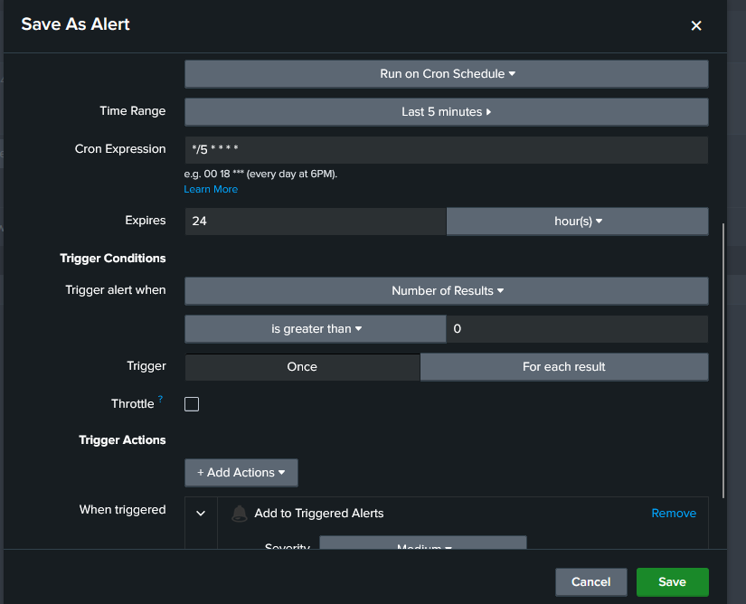

Take note of the time range we set, last 5 minutes. This means that it will run every 5 minutes and look at all the failed logons within that timeframe which exceeded 5 counts or attempts. The condition of the exceeded 5 count attempt came from our search query which we saved as an alert:

index=* source="WinEventLog:Security" EventCode=4625

| stats count by host

| where count &gt; 5

For our trigger actions we used add to triggered alerts.  This means that everytime the alert runs we can see it in the Trigger Alerts section. 

Testing the alert we created

Now back to our linux vmware, we will proceed to once again simulate a brute force attack on the rdp of client 1 using hydra.

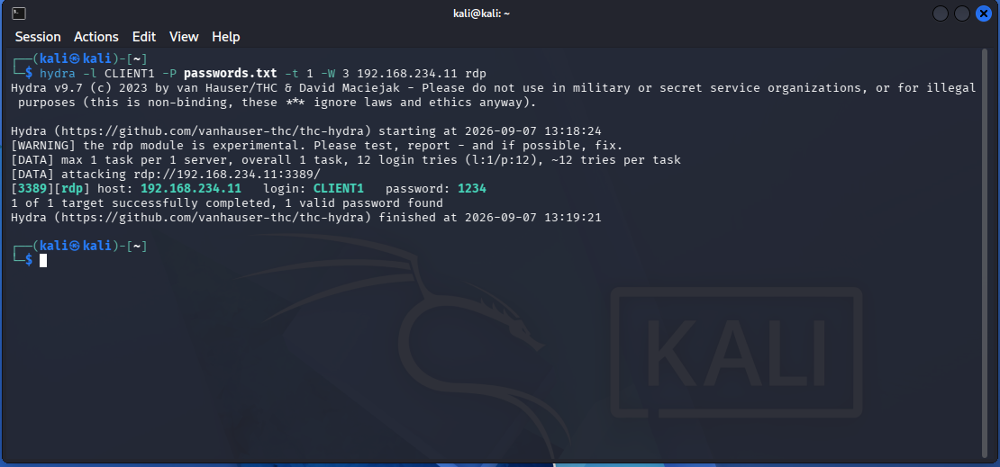

After attacking, lets now return to our splunk SIEM and check our alert caught the brute force attempt.

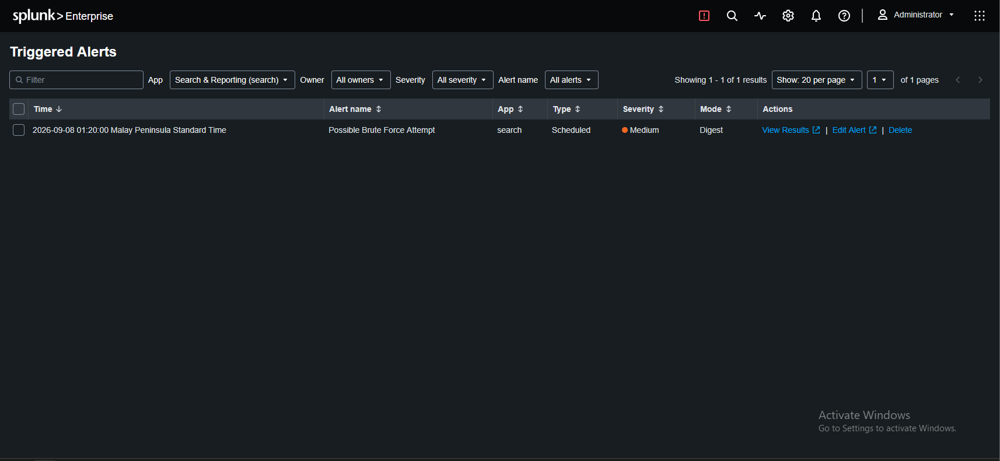

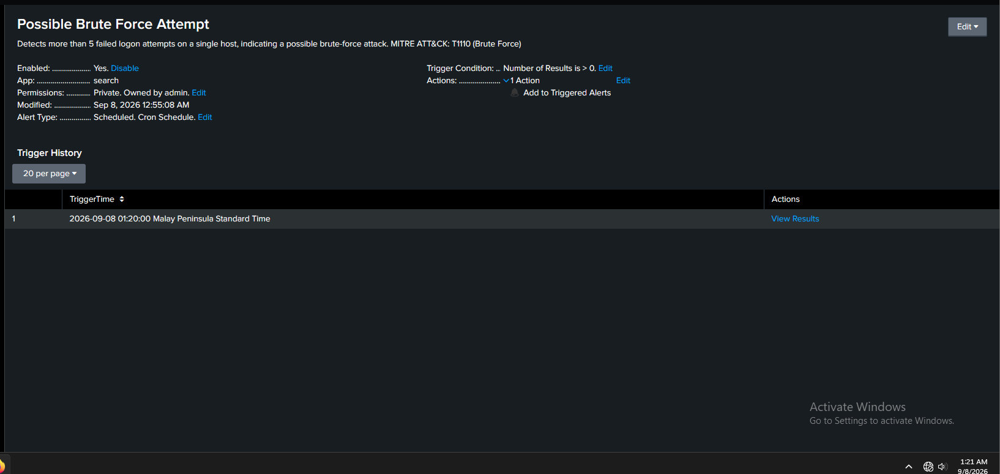

Upon checking the alerts tab we can see that the alert caught a possible brute force attempts. Lets check the View Results.

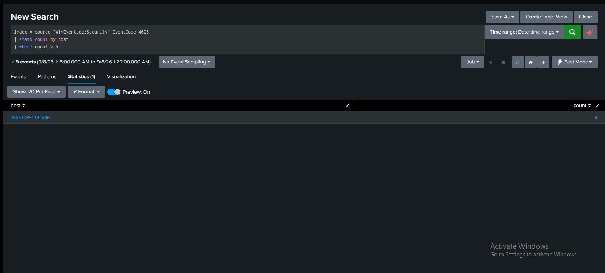

Upon further expanding the alert by pressing the view results here we can see what the alert found. Our client being monitored recorded 9 failed attempts in the span of 5 minutes.

Now that our alert works as intended, we will be making a way so we’ll get notified whenever our alert gets triggered so rather than going to the triggered alerts tab manually to see if any alerts have been triggered we’ll be able to see automatically anything that happens through the integration of webhooks. For this specific scenario I’ll be using discord to receive the triggered alerts from splunk. 

Now to do this firstly get a webhook from your channel in discord. Once we have it lets proceed to splunk and navigate back to our alerts tab where we will edit our alert.

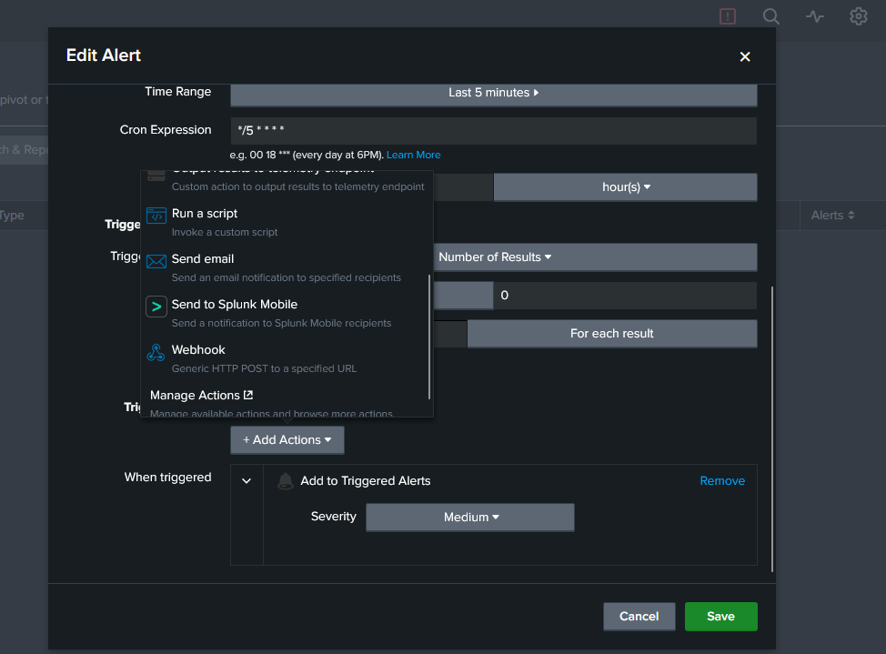

For here we’ll be using run a script, as webhooks for splunk and discord are not reliable as discord requires a content field. But nevertheless we will still be using a webhook but we’ll be using it on a script we’ll make which will send the alert to our discord channel.

The script we’ll be using

curl -H "Content-Type: application/json" -d "{\"content\": \"Possible RDP Brute Force detected on your monitored host\"}" "DISCORD _WEBHOOK_URL"

Dissecting the script:

Curl 

– also known as client URL, its a command line tool that sends web requests. In our case, its sending data to discord through the use of our webhook

-H “Content-Type:application/json” 

	- this is our header, its telling that what we’re sending or the content that we are sending to discord is in json format. This is needed so discord knows how to read the message we are sending. 

 -d "{\"content\": \"Possible RDP Brute Force detected on your monitored host\"}" "DISCORD _WEBHOOK_URL"

	- this is data that we are being sent or the content that we want to send in discord from our splunk siem. Here you can see we have the content field, whatever text we put in this section will be what discord displays. 

	- the reason it looks like this is because of JSON, this is the json format requires. Specifically it requires a “key” and a “value” pair. The keys and values are displayed as 

“key”:”value”  curly brackets at the front and the end of a key and value pair are also required so it becomes

{“key”:”value”}

So in our case you can see “content”:”Possible RDP Brute Force”}

But as you can see we have multiple \ or backslashes, there are commonly used to escape quotation marks because as you can see we have multiple quotation marks in our script, so to escape each quotation mark and execute the script we want and obtain the function we want we use these backslashes.

Now lets proceed to actually putting the script in our alert.

Firstly, we need to create a .bat script in our bin/scripts folder in splunk. Afterwards, lets the file name of our .bat script we just made in our alert section.

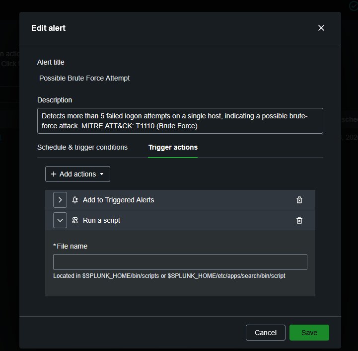

Once the setup is finished, you should receive a message on your discord and you now have a fully working alert notification system


## Adding more Alerts and turning the homelab into a detection lab

Lets add more on to what we currently have, it’s a good start but there is still more room for improvement and growth. Let’s start by implementing more detection rules to generate better and fine-tuned alerts that will help us with triaging incidents.

1.) Alert 1 For RDP Brute Force

```spl
index=* source="WinEventLog:Security" (EventCode=4624 OR EventCode=4625)
| stats 
    sum(eval(if(EventCode=4625, 1, 0))) as failures,
    sum(eval(if(EventCode=4624, 1, 0))) as successes 
    by Account_Name, host
| where failures > 5 AND successes > 0
```

This SPL query is to record successful (EventCode =4624) or unsuccessful (EventCode = 4625) events that happened more than 5 times. This is to help us identify if a brute attempt was created and if the brute force attempt succeeded.

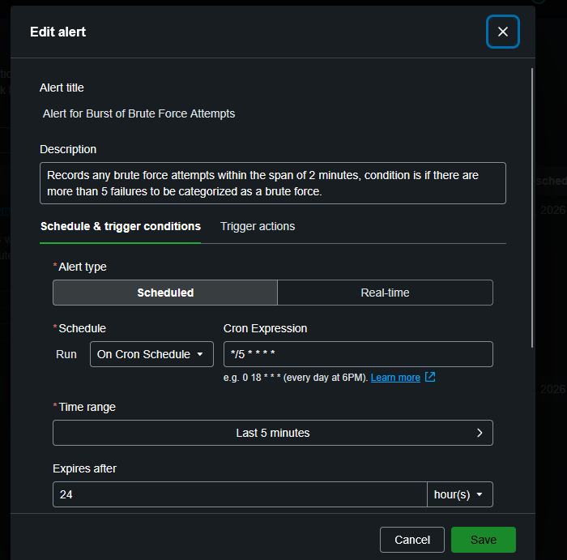

Result of the Alert:


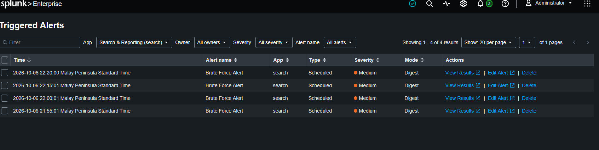


## Incident Report: IR-2026-001 - RDP Brute Force with Successful Logon

Severity: High | Status: Contained | MITRE: T1110 - Brute Force

### Alert Details

• Alert name: Possible RDP Brute Force - Failures and Successes

• Triggered: 10:20:00.000 PM / 20:20:00

• Monitored host: DESKTOP-1T4FB0H

• Affected account: CLIENT1

### Timeline (UTC+8)

| Time | Event |
| --- | --- |
| 10:17:19.264 PM | Hydra brute force begins from Kali VM |
| 10:17:19.264 PM - 10:18:07.413 PM | 9 failed logon attempts recorded (EventCode 4625) |
| 10:18:13.433 PM | 1 successful logon recorded (EventCode 4624) |
| 10:20:00.000 PM | Alert fires, Discord notification received |
| 10:20:00.000 PM | Response actions identified (manually) |

### Detection

SPL query that triggered this alert:

```spl
index=* source="WinEventLog:Security" (EventCode=4624 OR EventCode=4625)
| stats 
    sum(eval(if(EventCode=4625, 1, 0))) as failures,
    sum(eval(if(EventCode=4624, 1, 0))) as successes 
    by Account_Name, host
| where failures > 5 AND successes > 0
```

Results:
- Account_Name: CLIENT1
- Host: DESKTOP-1T4FB0H
- Failures: 9
- Successes: 1


### Analysis

The alert we made detected 9 failed logon attempts followed by 1 successful logon on DESKTOP-1T4FB0H which targets the account CLIENT1 within the detection window.  Although we can see on the 2nd result there are 3 recorded successes, this is due to the reason that these 3 successes represent the RDP session establishment which usually includes the initial logon with correct credentials, RDP session being created, special privileges being assigned to the session. The pattern observed is consistent with the behavior of an automated brute force attack. Specifically, a high volume of failures in a short timespan followed by a successful login does not resemble normal user behaviour.

<span style="color:red;">Review: counts alone do not establish which successes were RDP session establishment. Correlate the raw logon types, source address and identifiers.</span>

The attacker (Kali VM) used Hydra to systematically attempt passwords against the RDP service. Once a valid password was found, Hydra logged in briefly then dropped the session consistent with credential validation behavior rather than an actual interactive user session.

### Indicators of Compromise (IOCs)

| Type | Value |
| --- | --- |
| Attacker IP | 192.168.234.130 (KALI VM IP) |
| Target host | DESKTOP-1T4FB0H |
| Target account | CLIENT1 |
| Protocol | RDP |
| Tool used | Hydra (simulated) |

### Response Actions Taken

Note: This environment currently consists of a SIEM only. The following response actions would be performed manually upon alert trigger.

1. Disabled the compromised account:

net user CLIENT1 /active:no

2. Blocked attacker IP via Windows Firewall:

netsh advfirewall firewall add rule name="Block Attacker" dir=in action=block remoteip=[KALI IP]

### Verdict

Confirmed brute force attack with successful credential compromise. The attacker gained access to CLIENT1 on DESKTOP-1T4FB0H via RDP. The attack scenario was simulated in an isolated lab environment.

### Limitations &amp; Recommendations

Response was performed manually as the environment consists of a SIEM only with no EDR or XDR. An EDR solution such as Wazuh would allow for automated account isolation upon alert trigger. (This is to be added)

<span style="color:red;">Review: this limitation describes the earlier SIEM-only stage. The later sections document Wazuh marker responses; automated containment remains separate.</span>

Recommendation: Implement an Account Lockout Policy (e.g., lock after 5 failed attempts) to mathematically break automated brute-force tools.

2.) Alert 2 - New Local Account Created (4720)

```spl
index=* source="WinEventLog:Security" EventCode=4720
| rex field=Message "New Account:\s+Security ID:\s+\S+\s+Account Name:\s+(?P<Target_User_Name>\S+)"
| rex field=Message "Subject:\s+Security ID:\s+\S+\s+Account Name:\s+(?P<Subject_User_Name>\S+)"
| table _time, host, Target_User_Name, Subject_User_Name
```


This SPL query is to catch any event that results in the EventCode=4720 which corresponds to the creation of a local account of the machine, along with presenting the time, host client the account is being created to, the username of the new account created, and who created the new local account. . Rex is used because the logs are collected in plain text format via WinEventLog, which dumps all event details into a single Message field. Rex uses pattern matching to navigate through that raw text and extract the specific values we need - Target_User_Name (the new account) and Subject_User_Name (who created it).

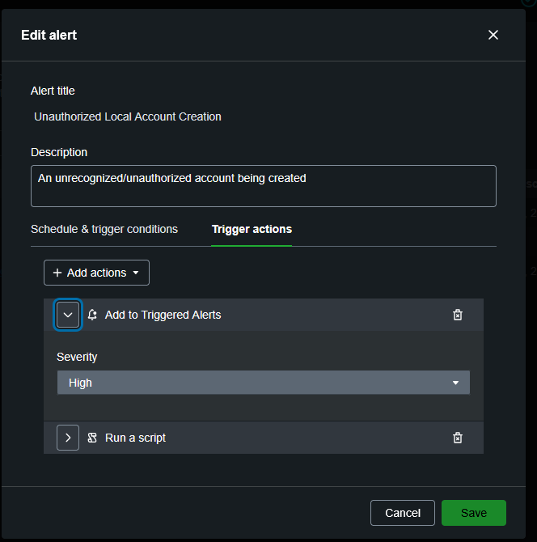

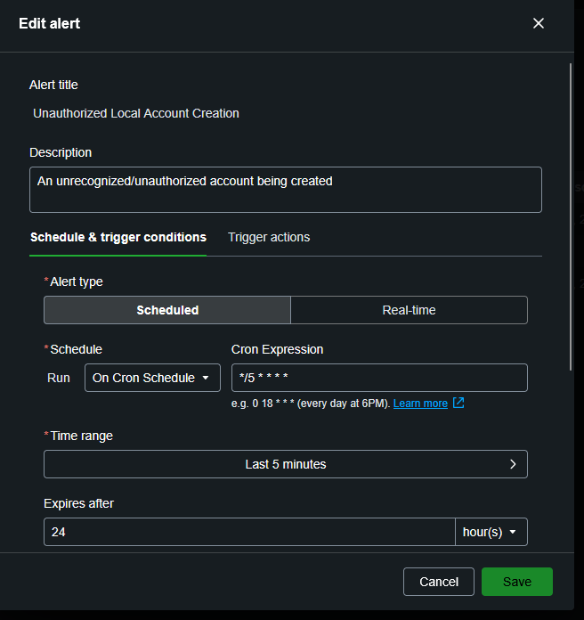

Testing the Alert

In testing the functionality of the alert we’ll be creating a user account on the compromised client (DESKTOP-1T4FB0H) which will simulate the attacker creating a backdoor account to maintain access to the system even if the original compromised account (CLIENT1) is disabled or the password is reset.

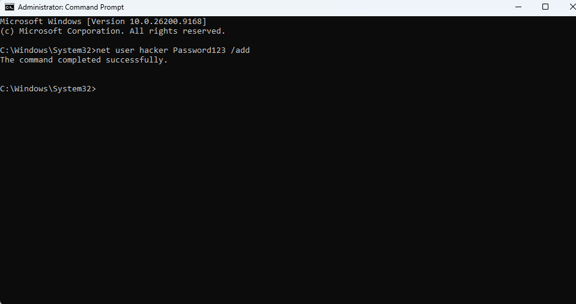


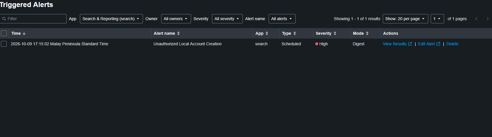

## Incident Report: IR-2026-002 - Unauthorized Local Account Creation

Related incidents:

IR-2026-001 - RDP Brute Force (attacker gained initial access via CLIENT1) 

Severity: High | Status: Contained | MITRE: T1136.001 – Create Account: Local Account

### Alert Details

• Alert name: New Local Account Created

• Triggered: 3:10:00.000 AM 

• Monitored host: DESKTOP-1T4FB0H

• Affected account: CLIENT1

### Timeline (UTC+8)

| Time | Event |
| --- | --- |
| 17:14:40.943 | Attacker Creates account on compromised Client1 |
| 17:14:40.943 | EventCode 4720 recorded on DESKTOP-1T4FB0H |
| 17:15:02 | Alert fires, Discord notification received |
| 17:17:02 | Response actions performed manually |

### Detection

SPL query that triggered this alert:

```spl
index=* source="WinEventLog:Security" EventCode=4720
| rex field=Message "New Account:\s+Security ID:\s+\S+\s+Account Name:\s+(?P<Target_User_Name>\S+)"
| rex field=Message "Subject:\s+Security ID:\s+\S+\s+Account Name:\s+(?P<Subject_User_Name>\S+)"
| table _time, host, Target_User_Name, Subject_User_Name
```

Results:
- Account_Name: CLIENT1
- Host: DESKTOP-1T4FB0H
- Target_User_Name: hacker
- Subject_User_Name: Client1


### Analysis

The alert we engineered detected the creation of a new unauthorized local user account on DESKTOP-1T4FB0H as this attack is related to the brute force attack we simulated earlier. In this scenario the attacker created a local user account which serves as a backdoor account that allows them to regain access to the compromised client even when the client account gets disabled or it’s password is reset. 

### Indicators of Compromise (IOCs)

| Type | Value |
| --- | --- |
| Target host | DESKTOP-1T4FB0H |
| Target account | CLIENT1 (Compromised Account used to Create backdoor) |
| New Account | hacker |
| Tool used | Cmd net user command (simulated) |

### Response Actions Taken

Note: This environment currently consists of a SIEM only. The following response actions would be performed manually upon alert trigger.

1. Disabled the backdoor  account:

net user hacker /delete

2. Investigate Subject_User_Name (CLIENT1) — confirm it is the compromised account

from IR-2026-001 and ensure it is already disabled

### Verdict

Confirmed persistence attempt. The attacker used the previously compromised account CLIENT1 to create a new local backdoor account named hacker on DESKTOP-1T4FB0H. This ensures the attacker maintains access even if CLIENT1 is disabled. Attack scenario was simulated in an isolated lab environment.

### Limitations &amp; Recommendations

Response was performed manually as the environment consists of a SIEM only with no EDR or XDR. Wazuh active response rules would allow automatic deletion of unauthorized accounts upon alert trigger. 

Recommendation: Implement least privilege policy - standard users should not have permission to create local accounts.

3.) Alert 3 – User added to Administrator (4732)

index=* source="WinEventLog:Security" EventCode=4732

| rex field=Message "Member:\s+Security ID:\s+(?P&lt;Member_SID&gt;S-1-\S+)"

| rex field=Message "Subject:\s+Security ID:\s+\S+\s+Account Name:\s+(?P&lt;Subject_User_Name&gt;\S+)"

| rex field=Message "Group:\s+Security ID:\s+\S+\s+Group Name:\s+(?P&lt;Group_Name&gt;\S+)"

| where Group_Name="Administrators"

| table _time, host, Member_SID, Subject_User_Name, Group_Name

This SPL query is to catch any event that results in the EventCode=4732 which corresponds to the addition of a user to the “Administrators” group which mean they would be given administrator privileges, the username of the compromised client, the host affected, along with showing the member SID which we can use to cross reference with EventCode 4720 to confirm which account it corresponds to, in our case it’s the “hacker” backdoor account.

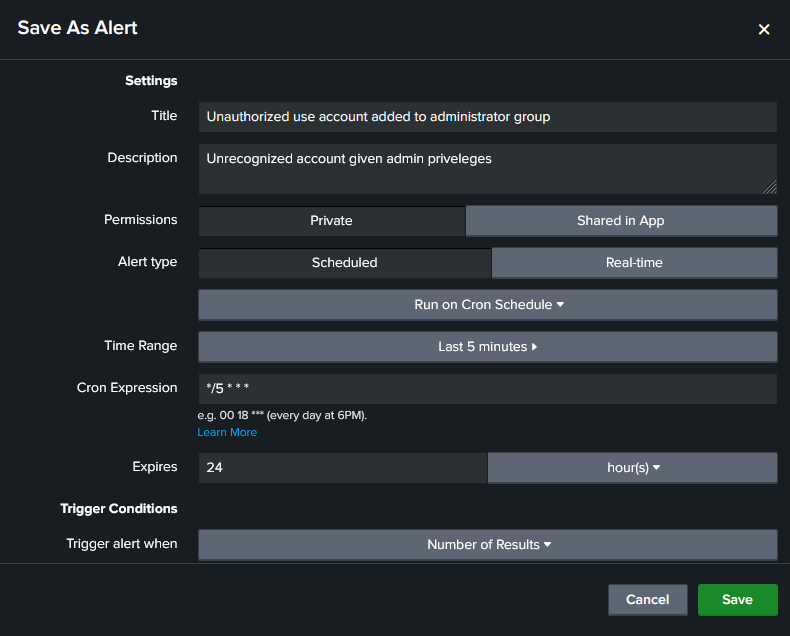

Testing the Alert

In testing the functionality of the alert the previous account we added in our simulation “hacker” will be added to the administrator which will simulate the attacker escalating himself and giving himself higher privileges to perform unrestricted actions on the compromised account

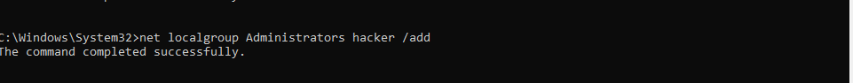


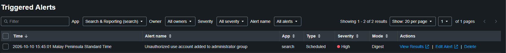

## Incident Report: IR-2026-003 - Unauthorized Administrator Addition

IR-2026-001 - RDP Brute Force (attacker gained initial access via CLIENT1) –

 IR-2026-002 - Unauthorized Local Account Creation (backdoor account established for persistent access) 

Severity: High | Status: Contained | MITRE: T1136.001 – Create Account: Local Account

### Alert Details

• Alert name: Unauthorized use account added to administrator group

• Triggered:15:45:01.000 / 3:45 PM

• Monitored host: DESKTOP-1T4FB0H

• Affected account: CLIENT1

### Timeline (UTC+8)

| Time | Event |
| --- | --- |
| 15:42:45.073 | Attacker gives backdoor account active privileges |
| 15:42:45.073 | EventCode 4732 recorded on DESKTOP-1T4FB0H |
| 15:45:01.000 | Alert fires, Discord notification received |
| 15:47:01.000 | Response actions performed manually |

### Detection

SPL query that triggered this alert:

index=* source="WinEventLog:Security" EventCode=4732

| rex field=Message "Member:\s+Security ID:\s+(?P&lt;Member_SID&gt;S-1-\S+)"

| rex field=Message "Subject:\s+Security ID:\s+\S+\s+Account Name:\s+(?P&lt;Subject_User_Name&gt;\S+)"

| rex field=Message "Group:\s+Security ID:\s+\S+\s+Group Name:\s+(?P&lt;Group_Name&gt;\S+)"

| where Group_Name="Administrators"

| table _time, host, Member_SID, Subject_User_Name, Group_Name

Results:
- Host: DESKTOP-1T4FB0H
- Member_SID: S-1-5-21-2550871505-1987996103-1759814450-1009 (“hacker”)
- Subject_User_Name: Client1
- Group Name: Administrator


### Analysis

The alert we engineered detected the creation of a local user account on DESKTOP-1T4FB0H being given admin privileges via being added to the administrator group as this attack is related to unauthorized creation of a local account we simulated earlier. In this scenario the local user account the attacker previously created was added to the administrator group thus giving them unrestricted control beyond what a normal user has over the infected client. 

### Indicators of Compromise (IOCs)

| Type | Value |
| --- | --- |
| Target host | DESKTOP-1T4FB0H |
| Subject account | CLIENT1 (Account that performed the action) |
| Escalated Account | Hacker (account added to administrator group) |
| Group | Administrators |

### Response Actions Taken

Note: This environment currently consists of a SIEM only. The following response actions would be performed manually upon alert trigger.

1. Remove account from Administrators group:

net localgroup Administrators hacker /delete

2. Delete the backdoor account entirely:

### net user hacker /delete

3. Review all members of the Administrators group for unauthorized accounts:

net localgroup Administrators

### Verdict

Confirmed privilege escalation attempt. Following the creation of the backdoor account hacker in the previous event IR-2026-002, the attacker elevated the account to Administrator level giving full system control. Attack scenario was simulated in an isolated lab environment.

### Limitations &amp; Recommendations

Response was performed manually as the environment consists of a SIEM only with no EDR or XDR. Wazuh would allow automated removal of unauthorized group membership upon alert trigger. 

Recommendation: Implement privileged access monitoring and restrict who can modify the Administrators group via Group Policy.

## Incident Report: IR-2026-004 - Script Interpreter Spawning Shell

Related incidents: 

IR-2026-001 - RDP Brute Force (attacker gained initial access via CLIENT1) –

IR-2026-002 - Unauthorized Local Account Creation (backdoor account established for persistent access) 

IR-2026-003 - User Added to Administrators (attacker gained full system control before executing this script)

Severity: High | Status: Contained | MITRE: T1059.005 – Command and Scripting Interpreter: Visual Basic

### Alert Details

• Alert name: Script Interpreter Spawning Shell

• Triggered: 21:36:39.903 / 9:37PM

• Monitored host: DESKTOP-1T4FB0H

• Affected account: CLIENT1

### Timeline (UTC+8)

| Time | Event |
| --- | --- |
| 21:36:39.903 / 9:37PM | test.vbs executed on DESKTOP-1T4FB0H |
| 21:36:39.903 / 9:37PM | Sysmon EventCode 1 recorded — wscript spawning cmd |
| 21:40:02 / 9:40PM | Alert fires, Discord notification received |
| 21:42:00 / 9:42PM | Response actions performed manually |

### Detection

SPL query that triggered this alert:

index=main source="WinEventLog:Microsoft-Windows-Sysmon/Operational"

sourcetype=XmlWinEventLog

| spath path=Event.System.EventID output=sysmon_event_id

| rex field=_raw "&lt;Data Name=['\"]ParentImage['\"]&gt;(?&lt;parent_image&gt;[^&lt;]*)&lt;/Data&gt;"

| rex field=_raw "&lt;Data Name=['\"]Image['\"]&gt;(?&lt;process_image&gt;[^&lt;]*)&lt;/Data&gt;"

| rex field=_raw "&lt;Data Name=['\"]CommandLine['\"]&gt;(?&lt;process_command_line&gt;[^&lt;]*)&lt;/Data&gt;"

| where sysmon_event_id="1"

    AND match(parent_image, "(?i)wscript[.]exe$")

    AND match(process_image, "(?i)(cmd|powershell)[.]exe$")

| table _time host parent_image process_image process_command_line

| sort - _time

Results:
- Host: DESKTOP-1T4FB0H
- Parent Image: C:\Windows\System32\wscript.exe
- Process Image: C:\Windows\System32\cmd.exe
- Process Command Line:  "C:\Windows\System32\cmd.exe"


### Analysis

The SPL Query engineered monitors Sysmon process creation events which correspond to (EventCode 1) which we use as a basis to detect when a windows script host executable such as Windows Script Host (wscript) or Console Script Host (cscript) spawns a command shell either cmd.exe or powershell.exe. Wscript and Cscipt are legitimate tools which are designed to execute script files. However, they have no reason especially within a professional setting to launch command interpreters. The parent/child process relationship in this scenario is a strong indicator of malicious script execution which is commonly observed when an attacker makes use of a VBScript to execute commands on a compromised system. In this scenario we created a VBScript file (test.vbs) to replicate the behavior of launching a command interpreter.

### Indicators of Compromise (IOCs)

| Type | Value |
| --- | --- |
| Target host | DESKTOP-1T4FB0H |
| Parent Process | Wscript.exe |
| Child Process | Cmd.exe |
| Script File | test.vbs |
| Technique | VBScript spawning Command Shell |

### Response Actions Taken

Note: This environment currently consists of a SIEM only. The following response actions would be performed manually upon alert trigger.

1. Kill the spawned process:

taskkill /IM cmd.exe /F

2. Locate and delete the vbs file:

del C:\path\to\test.vbs

3. Investigate CommandLine field in Splunk to determine what commands were executed

### Verdict

Confirmed malicious script execution. Wscript.exe spawned cmd.exe which is not a common or normal behavior observed for any legitimate script. The technique used is commonly observed in phishing and for the delivery of malware. Attack scenario was simulated in an isolated lab environment.

<span style="color:red;">Review: wscript.exe spawning cmd.exe can also occur in legitimate scripts. This was a controlled test; investigate context before classifying real activity.</span>

### Limitations &amp; Recommendations

Response was performed manually as the environment consists of a SIEM only with no EDR or XDR. An EDR would automatically kill the child process and isolate the host upon detection.

Recommendation: Disable Windows Script Host for users that do not require it via Group Policy to prevent VBScript execution entirely.

Additional Notes:

wscript.exe contents

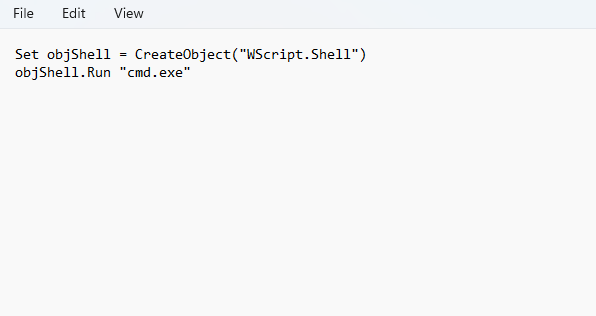

## Incident Report: IR-2026-005 – Encoded Powershell

Related incidents: 

IR-2026-001 - RDP Brute Force (attacker gained initial access via CLIENT1) –

IR-2026-002 - Unauthorized Local Account Creation (backdoor account established for persistent access) 

IR-2026-003 - User Added to Administrators (attacker gained full system control before executing this script)

IR-2026-004 - Script Interpreter Spawning Shell (attacker established command execution before running encoded PowerShell)

Severity: High | Status: Contained | MITRE: T1027 — Obfuscated Files or Information / T1059.001 — PowerShell 

Alert Details

• Alert name: Encoded PowerShell Execution

• Triggered: 00:50:01 / 12:50AM

• Monitored host: DESKTOP-1T4FB0H

• Affected account: CLIENT1

### Timeline (UTC+8)

| Time | Event |
| --- | --- |
| 00:49:20.568 / 12:49AM | PowerShell executed with -enc flag |
| 00:49:20.568 / 12:49AM | Sysmon EventCode 1 recorded |
| 00:50:01 / 12:50AM | Alert fires, Discord notification received |
| 00:50:01 / 12:50AM | Response actions performed manually |

### Detection

SPL query that triggered this alert:

index=main source="WinEventLog:Microsoft-Windows-Sysmon/Operational"

sourcetype=XmlWinEventLog

| spath path=Event.System.EventID output=sysmon_event_id

| rex field=_raw "&lt;Data Name=['\"]Image['\"]&gt;(?&lt;process_image&gt;[^&lt;]*)&lt;/Data&gt;"

| rex field=_raw "&lt;Data Name=['\"]CommandLine['\"]&gt;(?&lt;process_command_line&gt;[^&lt;]*)&lt;/Data&gt;"

| rex field=_raw "&lt;Data Name=['\"]ParentImage['\"]&gt;(?&lt;parent_image&gt;[^&lt;]*)&lt;/Data&gt;"

| where sysmon_event_id="1"

    AND match(process_image, "(?i)powershell[.]exe$")

    AND match(process_command_line, "(?i)-enc")

| table _time host process_image process_command_line parent_image

| sort - _time

Results:
- Host: DESKTOP-1T4FB0H
- Parent Image: C:\Windows\System32\WindowsPowerShell\v1.0\powershell.exe
- Process Image: C:\Windows\System32\WindowsPowerShell\v1.0\powershell.exe
- Process Command Line:  "C:\WINDOWS\System32\WindowsPowerShell\v1.0\powershell.exe" -enc VwByAGkAdABlAC0ASABvAHMAdAAgAEgAZQBsAGwAbwA=


### Analysis

The SPL Query engineered monitors Sysmon process creation events which correspond to (EventCode 1) which we use as a basis to detect when powershell gets executed with -enc (EncodedCommand) flag which allows powershell to accept base64 encoded commands as input rather than plain text. Although most of the time this isn’t an immediate sign of an attacker executed script, but its good to know that legitimate powershell usage rarely requires encoding. Most attackers use this to obfuscate their commands and evade basic detection which look for suspicious keywords observable in plain text. Decoding the Base64 string is a critical step in determining the full scope of what was executed on the compromised system.

### Indicators of Compromise (IOCs)

| Type | Value |
| --- | --- |
| Target host | DESKTOP-1T4FB0H |
| Parent Process | powershell.exe |
| Flag used | -enc |
| Encoded cmd | VwByAGkAdABlAC0ASABvAHMAdAAgAEgAZQBsAGwAbwA= |
| Decoded cm | Write-Host Hello |

### Response Actions Taken

Note: This environment currently consists of a SIEM only. The following response actions would be performed manually upon alert trigger.

1. Kill the powershell process:

taskkill /IM powershell.exe /F

2. Decode the command to determine what was executed:

[Text.Encoding]::Unicode.GetString([Convert]::FromBase64String($encoded))

3. Investigate ParentImage to determine what launched PowerShell

### Verdict

Confirmed obfuscated command execution. Powershell was launched with a Base64 encoded command with the -enc flag this technique is often used by attackers to hide their malicious commands from log inspection. Decoding the Base64 string reveals the actual command which was executed. However, it is important to note that -enc usage is not often definite proof of malicious intent or proof of an attack. Attack scenario was simulated in an isolated lab environment.

### Limitations &amp; Recommendations

Response was performed manually as the environment consists of a SIEM only with no EDR or XDR. An EDR would automatically block encoded PowerShell based on behavioural rules. 

Recommendation: Enable PowerShell Script Block Logging via Group Policy — this automatically logs the decoded command regardless of encoding, making the -enc obfuscation technique completely ineffective.

Additional Information for IR-2026-005

Command executed to trigger alert

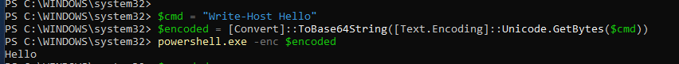

1st line: The command to be executed

2nd line: converting the command to Base64 thus obfuscating it.

3rd line: executing the command on powershell with the -enc flag

## Incident Report: IR-2026-006 – Windows Even Log Cleared

Related incidents: 

- IR-2026-001 through IR-2026-005 (attacker cleared logs to destroy local evidence of the entire attack chain)

Severity: Critical | Status: Contained | MITRE: T1070.001 - Indicator Removal: Clear Windows Event Logs

Alert Details

• Alert name: Windows Event Log Cleared

• Triggered: 02:12:52.509 / 02:12AM

• Monitored host: DESKTOP-1T4FB0H

### Timeline (UTC+8)

| Time | Event |
| --- | --- |
| 02:12:52.509 / 02:12AM | wevtutil cl Security executed on DESKTOP-1T4FB0H |
| 02:12:52.509 / 02:12AM | EventCode 1102 recorded |
| 02:15:02 / 2:15AM | Alert fires, Discord notification received |
| 02:17:00 / 2:17AM | Response actions performed manually |

### Detection

SPL query that triggered this alert:

```spl
index=* source="WinEventLog:Security" EventCode=1102
| table _time, host, Message
```

Results:
- Host: DESKTOP-1T4FB0H
- Message: The Audit log was cleared


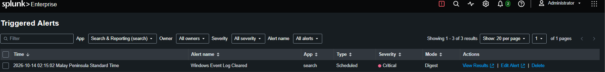


### Analysis

The SPL Query engineered monitors EventCode 1102 which is generated whenever the Windows Security Log is cleared. This is most certainly never a legitimate action within a monitored environment, the clearing of the security log destroy all local evidence of any preceding events which in our scenario included the login attempts, account creation, privilege excalation, and the execution of script. Due to these reasons this is a strong indicator of an attacker trying to erase their traces or cover their tracks after completing the attack chain. However, as all events were previously forwarder to Splunk prior to being cleared by the attacker, all complete evidence from the IR-2026-001 through IR-2026-005 remains recorded, this emphasizes the importance and core value of cetralised log forwarding in a SOC environment.

### Indicators of Compromise (IOCs)

| Type | Value |
| --- | --- |
| Target host | DESKTOP-1T4FB0H |
| Action | Security Event Log cleared |
| Tool | wevtutil cl Security (simulated) |

### Response Actions Taken

Note: This environment currently consists of a SIEM only. The following response actions would be performed manually upon alert trigger.

1. The Local Windows Security log is gone. Therefore, do not rely on Event Viewer for evidence

2. Use Splunk as the primary evidence source. All events from IR-2026-001 through IR-2026-005 are preserved

3. Isolate the machine and begin forensic investigation using Splunk logs

### Verdict

Confirmed attempt at evading defenses evident by the clearing of Windows Security Event by the attacker to destroy all local evidence of the entire attack chain. However, all of the evidence have already been forwarded and recording to Splunk and all remain fully preserved. This demonstrates how crucial centralized log forwarding is in terms of rendering such evasion techniques ineffective in a properly configured SOC Environment. Attack scenario was simulated in an isolated lab environment.

### Limitations &amp; Recommendations

Response was performed manually as the environment consists of a SIEM only with no EDR or XDR. An EDR would automatically block encoded PowerShell based on behavioural rules. 

Recommendation: Configure Windows Event Log to be protected from clearing via Group Policy. Implement log forwarding to an isolated SIEM so clearing local logs never destroys evidence — as demonstrated in this lab.

Additional Informatio/ Tasks/ Troubleshooting 


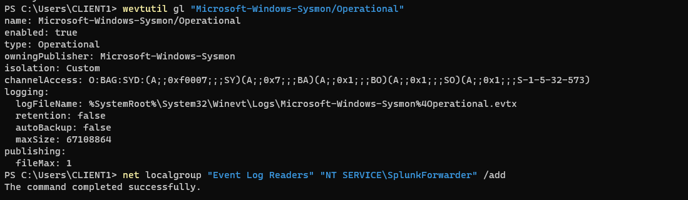

Added splunkforwarder to the “Event Log Readers” Group this is because we need splunk to be able to read different events and logs from the windows Sysmon log channel and forward it to our splunk. So to be able to get what we want we added the forwarder to the group with the read permissions.

The reason why we didn’t do this for earlier events was because for those we only have to read Standard channels or built in windows logs such as WinEventLog:Security but now we need be also getting logs and events from Custom channels like Microsoft-Windows-Sysmon/Operational which use Sysmon that we downloaded earlier create their own log channels separate from built in windows logs. These channels use custom-isolation and only accounts who are exclusively listed in channelAccess can read them, and since SplunkForwarder was yet to be added whenever it tried to forward or read any event within Sysmon it gets denied.

Additional Terminologies from writeups

Parent image: The immediate parent process that started the entire process. Or the program that started the new process 

Process image: The program being started by the parent image 

Process Command Line: How the program was started which includes what argument or instructions were used to launch the program.

Wscript: Windows Script Host – runs scripts with a GUI

Cscript: Console Script Host – runs a script in the terminal resulting in no popups

-enc: short for -EncodedCommand it makes use of Base64 encoded string as a command to execute rather than it just being plaintext. Basically encrypting the command so security tools wont be able to detect keywords.

<span style="color:red;">Review: Base64 is encoding, not encryption. The command can be decoded without a secret key.</span>

To restart splunk

```powershell
cd "C:\Program Files\Splunk\bin"
.\splunk restart
```

## Testing active response with wazuh (after installation on ubuntu and connecting/forwarding wazuh logs to splunk siem)

Alright so in this part we’ll firstly just be testing out the automated response capabilities of wazuh by creating a script that will only leave a marker. We’ll start out by doing something simple as that first just to prove, verify, and validate that the response mechanism works and once it does we’ll move on to enforcing proper and standard responses.

We will be making use of three pieces during this phase namely:

lab-marker.ps1 = Writes the signature or the one that leaves the marker

lab-marker.cmd = it’s the one that starts the .ps1 script

ossec.conf = this is what tells wazuh when to request the marker

### 1st Phase: Actually creating the marker script

Firstly on our monitored windows endpoint we’ll be creating the script in notepad. Specifically on the C:\Program Files (x86)\ossec-agent\active-response\bin\ path we’ll create a script on notepad

The Script:

```powershell
$ErrorActionPreference = 'Stop'
$message = [Console]::ReadLine() | ConvertFrom-Json
if ($message.command -ne 'add') { exit 0 }
$record = [ordered]@{
    time = [DateTime]::UtcNow.ToString('o')
    action = 'marker'
    rule = $message.parameters.alert.rule.id
    result = 'executed'
}
$record | ConvertTo-Json -Compress | Add-Content -LiteralPath "$PSScriptRoot\..\lab-marker.jsonl"
```

Alright so we have a lot to unpack here, I’ll firstly start by explaining what this entire code does and is for then go to specifics. So in its entirety the main purpose of this script is when this active response script triggers it reads the alert details that wazuh sent it, then it writes a log entry on a file called lab-marker.jsonl. Basically writing evidence that the alert ran properly which is exactly what we are trying to test here.

The script above will be called lab-marker.ps1 

.ps1 extension meaning it’s a powershell script this is important to note.

Now dissecting each line of the code $ErrorActionPreference = 'Stop' is a built in powershell variable. So what this entire line basically means is that it tells powershell to stop on any errors, that’s it. It just tells powershell to stop if anything goes wrong.

$message = [Console]::ReadLine() | ConvertFrom-Json

[Console]::ReadLine() reads one line from the standard input of the process. Standard input is an input channel for a running program. In our case Wazuh transports the message through that channel.  ConvertFrom-Json is self explanatory, just turn the json that wazuh sends as something that powershell understands as wazuh sends information in a json format, 

$message is a variable.  And | symbol means to pass the result on the left to the instruction on the right

So this line in its entirety means

Receive/read the message of wazuh

Convert that message from json

Keep the converted information in the variable $message

if ($message.command -ne 'add') { exit 0 } 

Look at the command value of message

-ne just means is not equal to

Exit 0 = finisn and add means do the action now

In its entirety it says if wazuh is not asking us to do anything (command != add) then finish without doing anything,

$record = [ordered]@{ 

Record is a variable, [ordered] keeps the pieces in the order you write them

{ starts the record } ends it.

Basically the start of an if statement if I were to compare it, it just says the start making a record containing several named pieces of information. What information? We’ll talk about those next.

<span style="color:red;">Review: [ordered]@{ creates an ordered dictionary; it does not start an if statement.</span>

The information:

    time = [DateTime]::UtcNow.ToString('o')

pretty self explanatory just says to put the current date and time in the record. This is to record when the script ran.

    action = 'marker'

This is our maker. 

    rule = $message.parameters.alert.rule.id

Put the detection rule id or number from the message of wazuh we put earlier in the $message variable into the record.

    result = 'executed'

Put the text “executed” in the record. Basically a label 

}

End of building the record.

The record now contains: 

When it happened

What action it was

Which rule triggered it

A result label

$record | ConvertTo-Json -Compress | Add-Content -LiteralPath "$PSScriptRoot\..\lab-marker.jsonl"

Take the record we made, turn it into a Json text on one line, and then add or append that line on the end of the marker file. The record will be written at active-response\lab-marker.jsonl on the folder above the current directory.

### The 2nd file (the launcher) lab-marker.cmd

```bat
@echo off
"%SystemRoot%\System32\WindowsPowerShell\v1.0\powershell.exe" -NoProfile -NonInteractive -ExecutionPolicy Bypass -File "%~dp0lab-marker.ps1"
```

The job of this .cmd file is to start powershell and ask it to run our marker script (.ps1 file)

@echo off: just means to not display every command as it runs so the ouput is quiet.

"%SystemRoot%\System32\WindowsPowerShell\v1.0\powershell.exe" -NoProfile -NonInteractive -ExecutionPolicy Bypass -File "%~dp0lab-marker.ps1"

"%SystemRoot%\System32\WindowsPowerShell\: Find and start powershell in our desktop.

-NoProfile -NonInteractive -ExecutionPolicy: Start without loading personal customizations to powershell, along with making it not ask questions which will require input from a user hence -NonInteractive, -ExecutionPolicy Bypass Allows the powershell process to run the script under the execution policy setting (bypass)

-File "%~dp0lab-marker.ps1": The file to run.

### Wazuh side (Ubuntu side)

Adding the active use case for our marker

```xml
<command>
  <name>lab-marker</name>
  <executable>lab-marker.cmd</executable>
  <timeout_allowed>no</timeout_allowed>
</command>
<active-response>
  <disabled>no</disabled>
  <command>lab-marker</command>
  <location>local</location>
  <rules_id>OBSERVED_RULE_ID</rules_id>
</active-response>
```

To add our active case we need to configure the wazuh ossec.conf file. If you’ve observed the settings use XML. XML puts values in between matching labels.

 E.g  &lt;name&gt;lab-marker&lt;/name&gt; this simply means that the name is lab-marker

The first block in our command defines the action hence &lt;command&gt; 

The &lt;name&gt;lab-marker&lt;/name&gt; says that this action that will be performed will be called or referred to as lab-marker

 &lt;executable&gt;lab-marker.cmd&lt;/executable&gt; tells that in order to execute that action it must run lab-marker.cmd. A key thing to note is that the file that needs to be run should already be on the windows endpoint.

  &lt;timeout_allowed&gt;no&lt;/timeout_allowed&gt; The action does not have a timed undo operation. Then comes after the closing &lt;/command&gt;

The section block decides when and where to use our command

&lt;active-response&gt; start describing an automatic response

  &lt;disabled&gt;no&lt;/disabled&gt;: the response is enabled

  &lt;command&gt;lab-marker&lt;/command&gt;: use the action named lab-marker which we established on the 1st block

  &lt;location&gt;local&lt;/location&gt;: this mean that the automatic response will run on the computer that produced the alert.

  &lt;rules_id&gt;OBSERVED_RULE_ID&lt;/rules_id&gt; : here we put the rule id that needs to be detected. In our case we use the rule.id=”92002” as it’s the corresponding rule on wazuh which correlates to our test of spawning windows cmd using a script interpreter with our wscript file.

&lt;/active-response&gt;: the closing for the active response section

Additional note: if you are wondering where we got the “92002” rule.id from and how we figured out it was the correct rule.id we got it from using the command

sudo tail -f /var/ossec/logs/alerts/alerts.json

on our ubuntu machine, so basically this shows us the new alerts that appeared on alerts.json which is where the alerts are stored.

Here is what we can see when we run the command. 

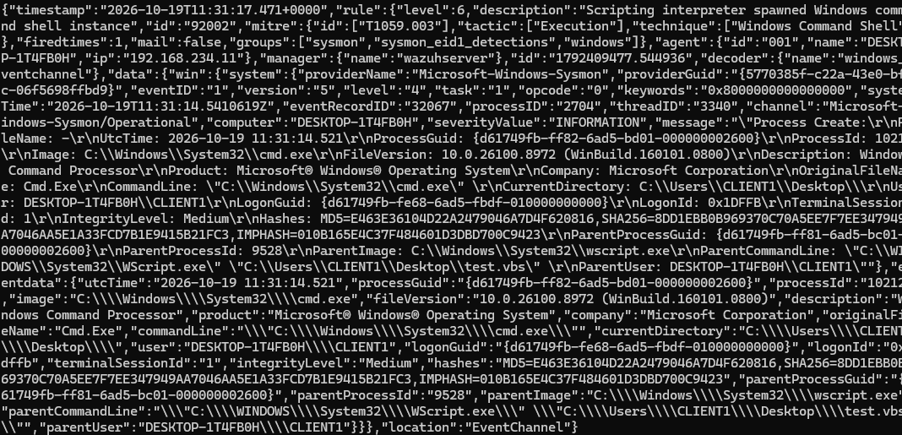

Although admittedly its really hard to read anything because its all just a bunch of text bundled up together but if you look closely and analyze it you can see the different sections of the alerts such as the timestamps, the rule, rule.id, etc. And this is where we got the 

### Proof/Images of the automated response test through generating a marker

First we ran the wscript. Time ran: 7:38PM

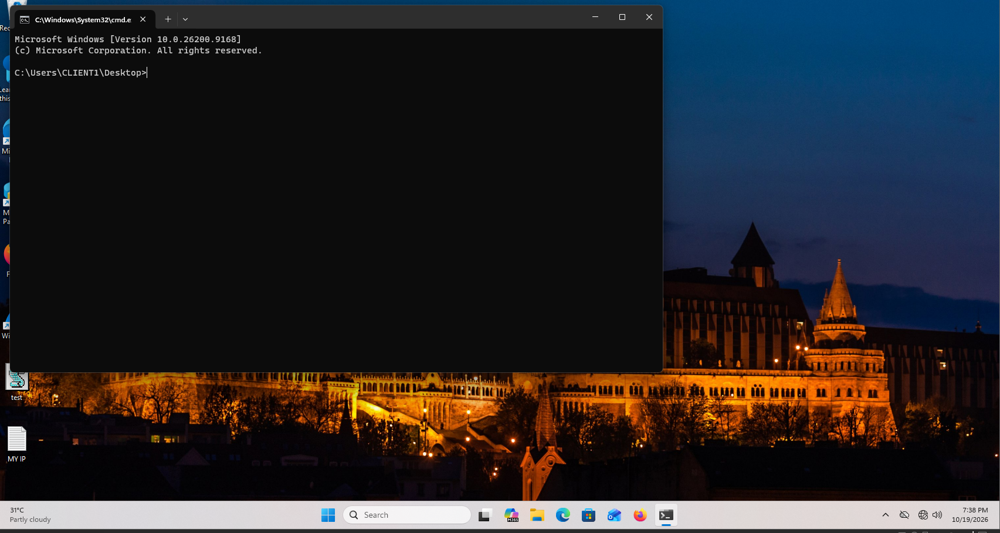

Validating the script ran and wazuh caught it via 
sudo tail -f /var/ossec/logs/alerts/alerts.json and searching through our splunk.

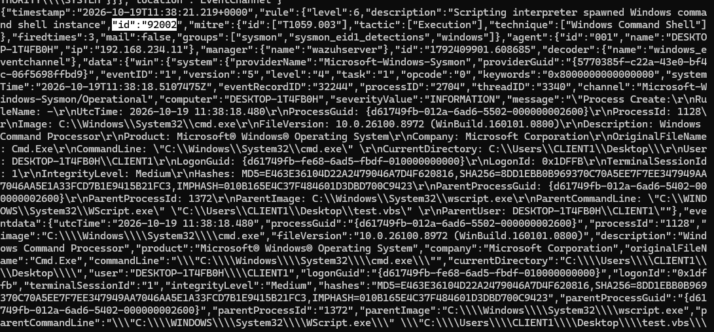


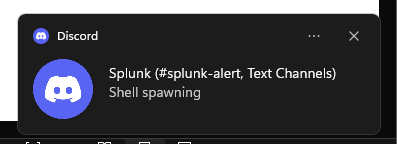

Both returned successful values along with our discord alert setting off.

Note: There are 2 results because I ran 2 tests and forgot to screenshot the 1st one hence I the 2nd attempt.

Lastly lets check if our marker was made we can do this by doing 2 things. 1 by going to the file location and checking the file if there is another record created or by using a powershell command that shows us the 5 latest additions to the file lets do both.

Test1: File check

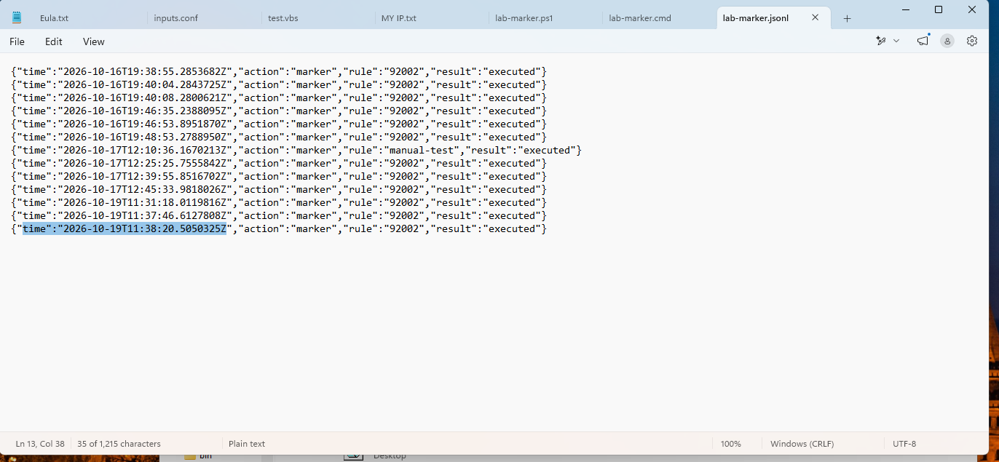

Test2: powershell check using getcontent and tail

Get-Content 'C:\Program Files (x86)\ossec-agent\active-response\lab-marker.jsonl' -Tail 5


Both are successful results, with this now we can go ahead and enforce actual active responses as we have now guaranteed that splunk and wazuh along with its automated response capabilities are fully functioning through our manual test.

<span style="color:red;">Review: this test confirms a native Wazuh marker response. It does not prove Splunk-triggered automation or containment.</span>

## Phase 6: API Triggered response

In this phase we’ll be testing if our API triggered response will work as eventually we will be needing it when asking wazuh to run a response on our monitored endpoint.

So eventually in this phase the entire flow will look like:

Splunk VM: sends a request -&gt; Ubuntu manager (Wazuh Server): Checks the request and permission of the requester -&gt; Windows Endpoint: runs the marker -&gt; lab-marker.json1: creates or receives a new record

<span style="color:red;">Review: the output filename is lab-marker.jsonl (letter l), not lab-marker.json1 (number 1).</span>

Now before we go into configuring the API lets first go into some security terms you and I will be encountering through this phase.

| Check | Plain meaning | What provides it |
| --- | --- | --- |
| Server identity | “Am I talking to my Wazuh server?” | HTTPS certificate |
| Your identity | “Who is making this request?” | API username and password |
| Your permissions | “What is this account allowed to do?” | RBAC permissions |

### HTTPS and Certificates

Https is what protects the connection and lets a client verify the servicer’s identity. Basically providing us with a way of being able to communicate without being vulnerable to Man in the middle (MITM) attacks.

 Certificates are basically the identity document of a server. An authorized CA or certificate authority is what signs that document. I’ve also tackled this in my phishing casebook analysis if you checked that out these terms will be easier to understand.

In the case of our homelab:

Our Ubuntu Server will hold the API server certificate along with the private key.

The Splunk VM will get a public CA certificate so it can verify the server

The private keys stay private.

When talking about the certificate, the certificate must identify the address we are currently using. For example if we connect to our ubuntu server 192.168.234.132 that ip needs to be included in the SAN of the certificate. SAN stands for Subject Alternative Name, its basically a list of all valid and authorized IP addresses and names.

### API account and RBAC

The splunk-response will be a Wazuh API account, its important to note that this account is separate from our Ubuntu login which hosts the wazuh server, the splunk login, and our windows login. Now our environment has a total of 4 login accounts with the introduction of this wazuh api account. This API account needs to be created before its authentication command can work.

RBAC as we all now stands for role based access control, in the simplest sense it says states what an account may do. In this phase we’ll be encountering this a lot some examples are

agent:read this lets the account read/inspect agent information. Only read and not write meaning they can inspect but not change or manipulate any agent information.

active-response:command this will let the account request for a response

Both will be put on to agent 001 which is the windows endpoint we are monitoring. So this eseentially gives the automation account a specific job, rather than giving it full manager administration and power.

### 1.) Now before anything lets first backup the API configuration in our Ubuntu server, this is so that we’’ll have no problems reverting back to the original config file if ever something goes wrong with our setup. Using the command:

sudo cp -a /var/ossec/api/configuration/api.yaml "/var/ossec/apio/configuration/api.yaml.bak-$(date +%Y%m%d-%H%M%S)"

<span style="color:red;">Review: the backup destination contains /var/ossec/apio/. It should use /var/ossec/api/.</span>

Next we check if the port for the API is listening via the command: 

sudo ss -lntp | grep ':55000'

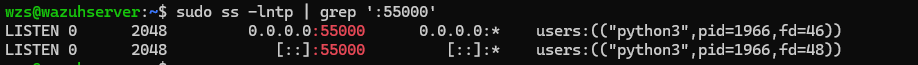

Lets dissect the command we just used:

Sudo: super-user do we already now this, basically grants administrator privileges when executing the command

Ss: displays socket information, basically network endpoints used by programs

-l: filters so it only shows listening sockets

-n: shows numeric addresses not resolved names

-t: shows only TCP sockets

-p: shows what processes is associated with each socket

| passes the output of ss into the next command

Grep ‘:55000’: only keeps line containing the text :55000

So basically its like an spl language we use in splunk where we use pipes for additional filters.

And from the result we got we see that the api port is listening

### 2.) after we’ve verified that the api port is listening we’ll be creating a directory that will house our lab certificates using the commands

```bash
sudo mkdir -p /root/wazuh-api-lab
sudo chmod 700 /root/wazuh-api-lab
```

-p: create parent directories if missing, and if not succeeds

Chmod: changes permissions for this directory

700: 1st digit is for the owner, Value 7 means read,write,enter (wrx), group = 0 no access, same with others 0.

```bash
sudo openssl req -x509 -newkey rsa:3072 -sha256 -days 365 -noenc 
-keyout /root/wazuh-api-lab/ca.key 
-out /root/wazuh-api-lab/ca.crt 
-subj "/CN=Wazuh Lab CA" 
-addext "basicConstraints=critical,CA:TRUE" 
-addext "keyUsage=critical,keyCertSign,cRLSign"
```

<span style="color:red;">Review: when pasting this as multiple Bash lines, add a backslash at the end of each continued line except the final line, or enter the command on one line.</span>

really long we have a lot to unpack here, 

sudo openssl req -x509 -newkey rsa:3072 -sha256 -days 365 -noenc

openssl req: calls openssls certificate request tool

-x509 produces a self signed certificate rather than a certificate signing request (CSR)

-newkey rsa:3072 generates a new RSA private key with a 3072-bit size.

-sha256: signs the certificate using a SHA-256 which is hash used to guarantee the integrity of data.

-days 365 is what states how long the certificate will be valid for, in our case we’ll be making it valid for 1 year (365 days)

-noenc saves the private key without passphrase encryption

-keyout /root/wazuh-api-lab/ca.key \

-out /root/wazuh-api-lab/ca.crt \

These are the 2 output files

ca.key is our private key used to sign certificates

ca.crt is the public CA key, which clients can use to verify certificates that are issued by this CA

-subj "/CN=Wazuh Lab CA" \

- Makes the certificates subject with the common name (CN) to Wazuh Lab CA

-addext "basicConstraints=critical,CA:TRUE" \

Declares that this certificate belongs to a certificate authority and can be used to validate certificates it signs.

critical means software must understand and enforce this extension or reject the certificate.

-addext "keyUsage=critical,keyCertSign,cRLSign"

Makes it so that the keys uses are to:

keyCertSign — sign certificates.

cRLSign — signing certificate revocation lists (lists of revoked certificates).

So all in all, we get a lab CA named Wazuh Lab CA. A “CA” pertains to a certificate authority which is responsible for signing certificates, in our case since we used a self signed certificate we are the certificate authority. We used OpenSSL to create the key and the certificate.

I wont be going to in depth regarding the certificates and keys in this lab as it is quite confusing to discuss and currently I am unable to explain it proficiently as I am now. But in simple terms and from my own understand, our private key is what we use to sign certificates basically we leave a marker or a signature to prove its integrity. The public key is what checks if the signed certificate is legitimate or not, if its been tampered with or not. If it matches or the checks succeed then the signature gets accepted.

### 3.) Now that we’ve created our lab Certificate Authority (CA) we will now create the API certificate.

sudo openssl req -new -newkey rsa:3072 -noenc \

  -keyout /root/wazuh-api-lab/api.key \

  -out /root/wazuh-api-lab/api.csr \

  -subj "/CN=192.168.234.132"

sudo openssl req -new -newkey rsa:3072 -noenc \

- we use openssl’s certificate request tool to create a mew certificate signing request. Where we ask to generate a new 3072-bit RSA key pair. We then save the private key without a passphrase through the -noenc.

  -keyout /root/wazuh-api-lab/api.key \

  -out /root/wazuh-api-lab/api.csr \

  -subj "/CN=192.168.234.132"

-the private key will be written at api.key while the signing request will be written at api.csr

- The requests common name is set to the IP address of our server. 

So in summary what this block of code does is that it creates a private key for our Wazuh API server along with a certificate signing request (CSR). Although in this phase there are yet to be certificates to be issued. The CSR will contain the public key of our server and the requested identity which is signed by our private key (api.key) which I discussed earlier. It’s important to note that this does not contain the private key itself as it should not be disclosed which is why in this documentation will not be included aswell I will just be referring to it as “private key”.

So the entire certificate signing process we now have is as follows

Api.key -&gt; signs the request -&gt; api.csr -&gt; Us (CA) signs a certificate using ca.key -&gt; api.crt

Now we have 2 keys the api.key and the ca.key

api.key: just remember that this is the private key that proves the identity of the server which is our Wazuh Api Server

ca.key: our key when signing certificates.

### 4.) Now we’ll be creating a small settings file using:

sudo nano /root/wazuh-api-lab/api.ext

and then input these into the file which will be the settings that will identify the certificate as a server certificate which is valid for the IP of our Ubuntu server

basicConstraints=critical,CA:FALSE

keyUsage=critical,digitalSignature,keyEncipherment

extendedKeyUsage=serverAuth

subjectAltName=IP:192.168.234.132

basicConstraints=critical,CA:FALSE: states that the certificate belongs to an endpoint not a CA

keyUsage=critical,digitalSignature,keyEncipherment : here is states that the key allows for signing which can prove the identity of the server. Also permitting RSA key encryption

extendedKeyUsage=serverAuth : this certificate is intended to identify a server accepting TLS connections just like our Wazuh API

subjectAltName=IP:192.168.234.132 : The certificate identifies server which is our IP. So if the client connects to a different IP it will fail the address check.

All in all this settings file is basically the label attached to our API’s certificate which tells what its capabilities are and what its allowed to do. And in summary is says that what we have is a TLS server certificate for our Ubuntu server, and that its key may authenticate but may not issue certificates.

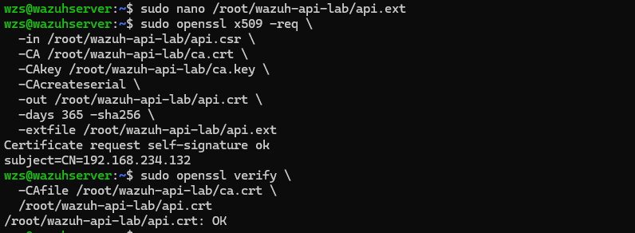

### 5.) Installing the API certificate on our wazuh server

sudo install -o root -g wazuh -m 640 \

  /root/wazuh-api-lab/api.key \

  /var/ossec/api/configuration/ssl/lab-api.key

sudo install -o root -g wazuh -m 640 \

  /root/wazuh-api-lab/api.crt \

  /var/ossec/api/configuration/ssl/lab-api.crt

Both are eseentially the same with the different one is for the key and one is for the certificate. The commands copy the api private key and certificate into our Wazuh SSL directory. Where the owner has read/write access, the group has read access, and everyone else no access.

Now we configure the api config using sudo nano /var/ossec/api/configuration/api.yaml

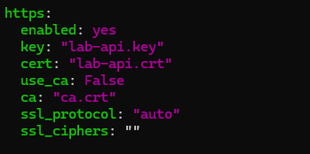

Then we restart wazuh-manager and test the connection afterwards where we’ll be expecting an authentication error as we have not logged in yet.

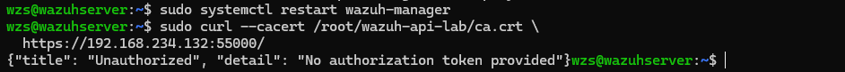

What we checked here is that we received an api reply without a certificate error.

Afterwards we’ll be making a copy of the public CA certificate to the VM we have our Splunk in using:

 sudo install -m 644 /root/wazuh-api-lab/ca.crt \

  /home/wzs/wazuh-lab-ca.pem

This is just so that we can request the file from our ubuntu machine into our Splunk VM as this makes transferring of the file easier

Then we run this on our Splunk VM

New-Item -ItemType Directory -Path 'C:\Lab' -Force

scp.exe wzs@192.168.234.132:/home/wzs/wazuh-lab-ca.pem C:\Lab\wazuh-lab-ca.pem

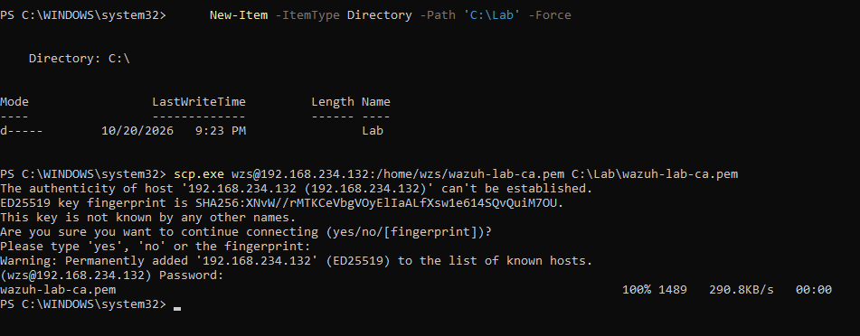

Now essentially what we did was just create a folder named lab and then we copy a file from our ubuntu server through an ssh session and then download it and save it to the lab folder we made prior.

###  6. Now that we’ve done that we’ll be testing the API connection between our Wazuh server and our Splunk Client

$apiBase = 'https://192.168.234.132:55000'

$caFile = 'C:\Lab\wazuh-lab-ca.pem'

$agentId = '001'

If you’ve been following me this far you’ll be able to recognize what those above are, if not those are the ip of the wazuh server and the port our Api server is using, the CA file we copied earlier, and the agentID we got when we deployed wazuh and connected it to our splunk.

Now using test-netconnection we can see if the API server and Splunk can connect with each other

Test-NetConnection 192.168.234.132 -Port 55000

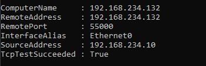

And the TcpTest succeeded which means we can now progress further are all checks have now been performed and we’ve verified connections have been established.

We can also make an additional check which sends a request to the Wazuh API to test connectivity with: 

curl.exe --ssl-revoke-best-effort --cacert $caFile "$apiBase/"

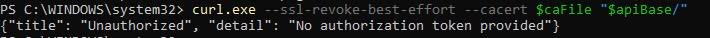

Don’t mind the unauthorized and no authorization token provided parts as we are yet to configure those parts. Currently, the objective is to test reachability and connectivity of our splunk vm and the wazuh server which is a success as we can make a request as seen above.

### 7.) Logging in our Wazuh API Administrator with admin privileges on our splunk VM

In order to create the limited automation account we are going to be needing an API administrator and in doing so we’ll be using the script:

$adminUser = 'wazuh'

$adminToken = curl.exe --ssl-revoke-best-effort --fail --silent --show-error --cacert $caFile --user $adminUser -X POST "$apiBase/security/user/authenticate?raw=true"

if ($LASTEXITCODE -eq 0 -and -not [string]::IsNullOrWhiteSpace($adminToken)) {

    Write-Host 'Login succeeded.'

} else {

    Write-Host 'Login failed.'

}

Note: Lots are happening here that I wont go deeper into, from this point on I wont be explaining code or script line per line as its not efficient when creating this documentation as its mainly for showcasing the security capabilities but I will still be creating summaries of what each script does.

In the case of the script above we use it so we can briefly log in and get the token needed to create the limited automation account which is what we’ll be doing in the next phase now that we are logged in. The last 2 blocks with the if statement are there so I can check if I still remember the password I set or no. Those are really not needed but I had to use it in this scenario as I’m forgetful.

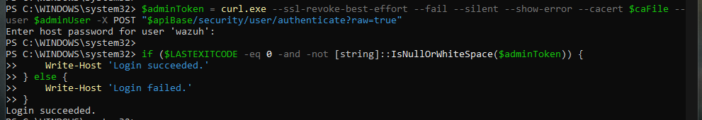

### 8.) Now this part is really long we’ll be placing an entire block of script within the same powershell window:

```powershell
function Invoke-LabApi {
    param(
        [string]$Method,
        [string]$ApiPath,
        $Body
    )
    $curlArgs = @(
        '--ssl-revoke-best-effort',
        '--fail',
        '--silent',
        '--show-error',
        '--cacert', $caFile,
        '-X', $Method,
        "$apiBase$ApiPath",
        '-H', "Authorization: Bearer $adminToken"
    )
    $tempFile = $null
    try {
        if ($null -ne $Body) {
            $tempFile = [IO.Path]::GetTempFileName()
            $json = $Body | ConvertTo-Json -Depth 10
            [IO.File]::WriteAllText(
                $tempFile,
                $json,
                [Text.UTF8Encoding]::new($false)
            )
            $curlArgs += @(
                '-H', 'Content-Type: application/json',
                '--data-binary', "@$tempFile"
            )
        }
        $reply = & curl.exe @curlArgs
        if ($LASTEXITCODE -ne 0) {
            throw 'API request failed.'
        }
        $result = ($reply -join "`n") | ConvertFrom-Json
        if ($result.error -ne 0 -or $result.data.total_failed_items -gt 0) {
            $result | ConvertTo-Json -Depth 10
            throw 'Wazuh reported an error. Stop here.'
        }
        return $result
    }
    finally {
        if ($tempFile) {
            Remove-Item -LiteralPath $tempFile -Force
        }
    }
}
```

This block of script is associated with our helper. Before we dive deeper lets identify what a helper is in our case of automation. A helper is a reusable function that handles repeated work. So we define it once and whenever we need the work that this respective helper does we call it.

This helper we created in particular sends authenticated requests to the Wazuh API, attachesour certificate and administrator token, convert any request content into json format, send the request, checks for errors, and remove its temporary request file

So now rather than writing the entire long block everytime we can just call the helper with the method and the api path we need like:

Invoke-LabApi -Method GET -ApiPath '/security/users'

And get the exact same function. This specific request we made requests the list of wazuh users using our existing administrator token.

### 9.) Creating the restricted account in Splunk VM

And by restricted account I mean a Wazuh API account that as limited permissions. In this part we’ll be building 3 things and connecting them. 

Which are the User –&gt; role -&gt; Policy

Now we will be creating the policy, this script block defines what actions the Account can do and which agent it applies to

```powershell
$policy = Invoke-LabApi -Method POST -ApiPath '/security/policies' -Body @{
    name = 'lab-response-agent001'
    policy = @{
        actions = @('agent:read', 'active-response:command')
        resources = @('agent:id:001')
        effect = 'allow'
    }
}
```

```powershell
$policyId = $policy.data.affected_items[0].id
"Created policy ID: $policyId"
```

Most of the stuff in here are self explanatory such as which agent this policy applies to (agent:id:001)

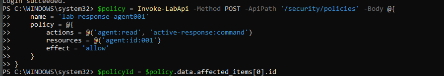

Now that’s done we’ll be creating a role. A role is a named package of permissions. 

```powershell
$role = Invoke-LabApi -Method POST -ApiPath '/security/roles' -Body @{
    name = 'lab-response-role'
}
```

```powershell
$roleId = $role.data.affected_items[0].id
"Created role ID: $roleId"
```

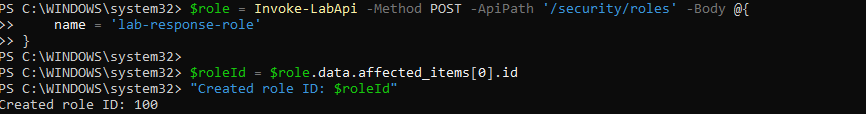

Afterwards we’ll be attaching a policy to that role.

Invoke-LabApi -Method POST -ApiPath "/security/roles/$roleId/policies?policy_ids=$policyId"

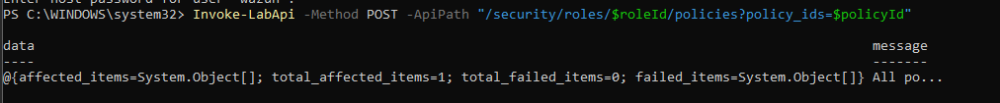

Once that’s done we’ll now create an account 

```powershell
$newCredential = Get-Credential -UserName 'splunk-response' -Message 'Choose a new password for the Wazuh automation account'
if ($null -eq $newCredential) {
    throw 'Account creation cancelled.'
}
$user = Invoke-LabApi -Method POST -ApiPath '/security/users' -Body @{
    username = 'splunk-response'
    password = $newCredential.GetNetworkCredential().Password
}
$userId = $user.data.affected_items[0].id
"Created user ID: $userId"
```

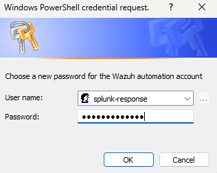

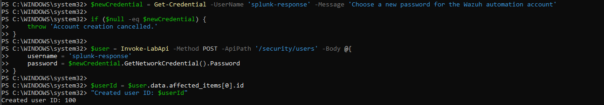

Now, plenty of things happened and I’ll be discussing what we just did. 

Basically what we did was create the restricted account, this restricted account is what will be responsible for our automated response. We created the policy and roles for this account. We attached the policy to the role, in our case the role we made is ‘lab-response-role’ so now the policies we created are enforced on that role.

After all that we created the user which we named “splunk-response” along with a password of our choosing. This is the Wazuh Api Account. And finally we attached the role to the user. In summary this is what it looks like. 

<span style="color:red;">Review: the role-to-user attachment command is not shown in this section: Invoke-LabApi -Method POST -ApiPath &quot;/security/users/$userId/roles?role_ids=$roleId&quot;. Verify that assignment before testing the account.</span>

splunk-response

    → has lab-response-role

        → includes lab-response-agent001 policy

            → allows the two actions on agent 001 

### 10.) Logging in with the restricted account

Now using this script we will login into the restricted account. The reason we want to login and access this account is so we can validate and prove that the newly created account and authenticate and read its permitted endpoint. 

```powershell
$apiToken = curl.exe --ssl-revoke-best-effort --fail --silent --show-error --cacert $caFile --user 'splunk-response' -X POST "$apiBase/security/user/authenticate?raw=true"
if ($LASTEXITCODE -ne 0 -or [string]::IsNullOrWhiteSpace($apiToken)) {
    throw 'Automation account login failed. Stop here.'
} else {
    Write-Host 'Automation account login succeeded.'
}
```


Now that we have been able to login lets check its access to agent 001:

curl.exe --ssl-revoke-best-effort --fail --silent --show-error --cacert $caFile "$apiBase/agents?agents_list=$agentId" -H "Authorization: Bearer $apiToken"

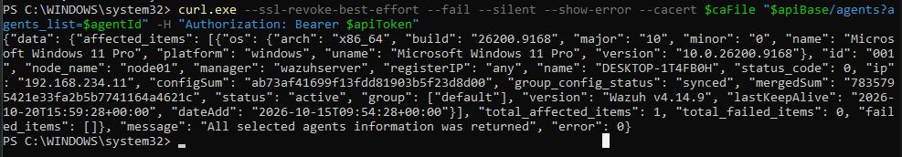

And here we have it, from what we got we can say that the agen-read permission worked along with the API login which means the API is reachable this test succeeded.

### 11.) Testing the Connection for the SIEM + XDR integration through the marker.

Alright, now were slowly connecting everything together. If you remember earlier in this phase we created the marker and connected the endpoint alert to the wazuh active response which generated a new line on the marker file. Now what we’ll be doing is checking the connection from our SIEM which is Splunk to our XDR which is Wazuh through the API and then performing the active response. Although we are still doing things manually, we are still currently making a request to the API through powershell.

Now in our Splunk vm we run: 

```powershell
$body = @{
    command = 'lab-marker0'
    arguments = @()
    alert = @{
        rule = @{
            id = 'lab-api-test'
        }
    }
} | ConvertTo-Json -Depth 8
```

And 

```powershell
$bodyFile = Join-Path $env:TEMP 'wazuh-marker-request.json'
[IO.File]::WriteAllText(
    $bodyFile,
    $body,
    [Text.UTF8Encoding]::new($false)
)
```

These 2 blocks are for running the request. Basically the 1st block is building the request here we run the registered response which is “lab-marker0” which we’ve already established prior. Along with including alert.rule.id as “lab-api-test” this is a label that we created in this powershell script so we can recognize the test in the marker record when we run it.

The 2nd block is just saving the request we made (the 1st block) and stores it in $bodyfile. 

Now that done, all that’s left is to send it lets go!

curl.exe --fail --silent --show-error --cacert $caFile -X PUT "$apiBase/active-response?agents_list=$agentId" -H "Authorization: Bearer $apiToken" -H 'Content-Type: application/json' --data-binary "@$bodyFile"

<span style="color:red;">Review: this Windows curl command needs --ssl-revoke-best-effort, as used by the working commands elsewhere in this document. This lab CA does not publish revocation information.</span>


Alright! We got a good result, but its to early to celebrate. Let’s check on our monitored endpoint if the active response we actually built worked and if the marker appeared.

Once again we’ll be doing the 2 checks. Checking it via the actual contents of the marker file itself and via powershell.

File checking through notepad:

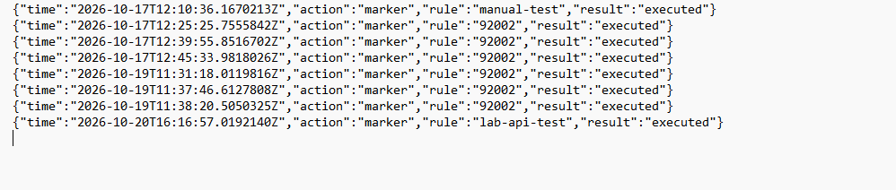

And there we have it, the lab api test we made specifically as the label for our test officially made it through.

Checking through poweshell:


We are also greeted with a successful result for the powershell command.

### Reflection and Summary on this Phase:

We did a lot this phase, this is the lengthiest so far. This phase actually took me 2 days to complete, and within those 2 days I have learned a lot and I hope you did too if you ever do decide to read this and try and recreate this project of mine. We started from creating the certificated needed to actually secure the connection between our Splunk VM and the Wazuh API. It’s my first time actually doing something like this, so its expected I took long. From this I learned that these certificates are what verify the identity of the server while the user, password, and tokens are what identify the person or program that is making the request. Afterwards, we created a restricted automation account and assigned it to our monitored endpoint which was agent 001. Although currently, it might not seem much as what we did was only manual testing. But it is through this testing that we can progress forward and now that we’ve established the connection the next step if to actually make Splunk request actions from Wazuh. This definitely opened my eyes and made me understand how to these different tools SIEM and an XDR communicate and work with each other.
